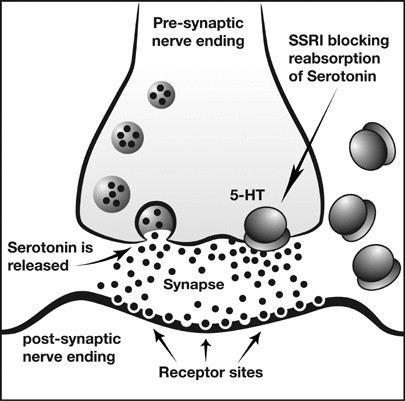

## Treatment and Management

### **Biochemical: MAOIs and SSRIs**

* Numerous anti-depressant drugs are available which affect neurotransmitter levels in the brain.
* **Monoamine Oxidase Inhibitors (MAOIs)**
  * Inhibits the work of an enzyme known as monoamine oxidase.
  * Monoamine oxidase breaks down and removes neurotransmitters like norepinephrine, serotonin and dopamine.
  * Thus, MAOI prevents monoamine oxidase from breaking these neurotransmitters down, maintaining them at high levels in the synapse for the postsynaptic neurone.
  * **Side effects:**
    * Headaches/drowsiness
    * Insomnia
    * Nausea
    * Diarrhoea
    * Constipation
    * Addiction
    * Suicidal thoughts
  * It can cause issues with withdrawal and may interact with other medications – thus, MAOI is reserved for atypical depression (difficult to treat) when other treatments have been unsuccessful.
* **Selective Serotonin Reuptake Inhibitors (SSRIs).**
  * Acts on the neurotransmitter serotonin to stop it from being reabsorbed into the pre-synaptic neurone, keeping it at high levels in the synapse for the post-synaptic neurone.

    

  * However, fewer and less severe side effects than MAOIs depend on the patient’s response.
* Both MAOIs and SSRIs are more effective than placebos, although the impact is more noticeable for patients with moderate to severe symptoms and less with mild depression (Fournier et al., 2010).

### **Electro-Convulsive Therapy**

* **Last resort**: If biochemical and CBT are non-responsive.
* A study by Dierckx et al. (2012) included 1000 patients with unipolar or bipolar depression. It showed that ECT has similar effectiveness as antidepressants, resulting in around 50% remission (reduction in severity) rate.
* The benefits of ECT are short-term as it is administered in short sessions, in contrast to the maintenance effect created by ongoing drug therapy.
* Thus, relapse rates are just as high as those that stop antidepressant use; patient will have a reoccurrence of symptoms, requiring further treatment (Jelovac et al., 2013).

### **Cognitive Restructuring (Beck, 1979)**

* **Talking therapy**: One-on-one interactions between depressed patients and therapist.
* Techniques like questioning and identifying illogical
* Thinking are involved in determining and changing patients’ thinking.
* Begins with explaining the theory of depression using a cognitive triad so the patient knows that their thinking contributes to their depression.
* Further, patients are trained to observe and record their thoughts to help them recognise irrational/inaccurate beliefs.
* Once patients recognise their cognition, they can understand the link between their thoughts and their effect on behaviour and vice versa.
* Patients are trained to record dysfunctional thoughts to identify their occurrence in reality. They are then discussed in therapy to explore whether they really are an accurate reflection of reality.
* **Purpose of this reality testing:**
  * For patients to realise negative distortions in thinking for themselves.
  * **Reattribution**: a technique that tests automatic thoughts and assumptions by considering alternative causes of events.
  * Therapists can help reattribute patients' thoughts by identifying whether the causes of problems are internal or external to make them realise they were not responsible.
  * The therapy is completed when the patient can employ cognitive restructuring for themselves and see a reduction in depressive symptoms.
* **A study by Wiles et al. (2013)** showed that depressive symptoms reduce using CR in those that don’t respond to antidepressants.
  * A group of 469 depressed patients were randomly allocated to either the ongoing medications group or CBT.
  * Those who received therapy were 3 times more likely to show a reduction in depressive symptoms.

### **Rational Emotive Behavioural Therapy (REBT) (Ellis, 1962)**

* Based on the principles of **Stoicism**.
  * Stoicism is a philosophy based on a theory by Albert Ellis (1962) that an individual is not directly affected by external things but rather by their own perception of how they affect them.
  * Ellis identified that absolute, dogmatic thinking - referred to as "Musturbation" (e.g., "I must succeed at everything," "Others must treat me fairly") - is the root cause of irrational anxiety and emotional suffering.
  * Psychological distress and anxiety disorders are not caused directly by adverse life events, but rather by the **irrational beliefs** and interpretations an individual holds about those events.
  * According to Ellis, this is how depression should be identified and treated.

### Process of ABCDE model of psychological change

#|
||

Components

|

Examples

|

Description

||
||

**A**

Activating Event

|

* Unsuccessful at a job interview

|

Adversity in one’s life (not directly the cause of emotional upset or negative thinking)

||
||

**B**

Beliefs about event

|

* I’ll never get anywhere

* I’m just not good enough

|

Beliefs about the activating event which lead to emotional and behavioural problems

||
||

**C**

Consequences

|

* Feeling sad, tearful or angry

* Withdrawal from friends and family

* Refusal to apply for other work

|

​The emotional and behavioral outcomes resulting directly from the belief

||
||

**D**
Disputing

|

* Does it logically follow that because you failed one interview, you are totally incapable of getting a job?

* How is believing that you cannot cope helping improve your life?

|

The therapeutic intervention where the therapist actively challenges and confronts the patient's irrational beliefs.

||
||

**E**

Effective New Philosophy

|

* While missing out on this job is highly disappointing, failing one interview does not mean I am incapable or that I will never get anywhere. I am skilled enough to secure interviews, and with persistence and preparation, I can secure a suitable position in the future

|

The cognitive restructuring goal where irrational beliefs are replaced with rational, adaptive thoughts, leading to healthier emotional consequences.

||
|#

### Three Methods of Disputing (D)

During therapy sessions, the clinician actively confronts the patient's irrational beliefs using three distinct strategies:

1. Logical Disputing: Asking the patient whether their irrational belief makes logical sense (e.g., "Does it logically follow that because you failed one test, you are totally incapable of learning?").

2. Empirical Disputing: Asking for objective, factual evidence to back up the belief (e.g., "Where is the scientific proof or data showing that buttons or blood can physically destroy you?").

3. Pragmatic / Functional Disputing: Emphasizing the practical uselessness of holding onto the anxiety-provoking thought (e.g., "How is believing that you cannot cope helping you pass your exams or improve your life?").

### Evaluation of REBT

**Strengths**

* Empowers the Patient: It shifts control away from external factors (e.g., blaming a traumatic past or a specific conditioning event) and gives the patient direct control over changing their current internal thoughts.

* Highly Effective for GAD: REBT’s heavy focus on generalized irrational beliefs rather than a single specific stimulus makes it highly appropriate for treating Generalised Anxiety Disorder (GAD).

**Weaknesses**

* Confrontational Nature: Because the therapist must actively dispute and challenge the patient's thoughts, it can be perceived as aggressive. This requires high cognitive engagement, which may cause distress or lower compliance rates in highly anxious patients.

* Cognitive Focus Minimizes Biology: By assuming all emotional consequences stem purely from irrational beliefs, REBT may overlook inherent physiological factors (such as the sudden diphasic drop in blood pressure found in Haemophobia).

### Issues and Debates

* Free Will vs. Determinism: Behavioral models like classical conditioning (e.g., Little Albert) lean toward environmental determinism. REBT promotes free will, as it assumes that even if an individual experiences a negative environment, they retain the conscious choice to alter their internal cognitive processing.

* Application to Real Life: REBT provides highly practical, short-term, structured interventions that teach patients a lifelong self-help framework (the ABC model) to manage future anxiety triggers independently.