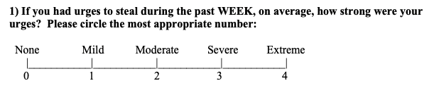

# Impulse Control Disorders and Non-Substance Addictive Disorder

## Characteristics

### **Definitions (Griffiths, 2005)**

* ICDs are characterised by failure to resist temptation/urge/impulse - individuals find it difficult to regulate thought and behaviour
  connected to a certain behaviour.
* **According to Griffiths, there are 6 components to any addiction
  disorder:**
  * **Salience:** the addiction becomes the single most important activity in their life. It dominates their thoughts, feelings and behaviour.
  * **Euphoria:** the addictive behaviour creates mood modification – feelings of being ‘high’ or escape and peace.
  * **Tolerance:** gradually, the person has to do more addictive behaviour to get the same effect.
  * **Withdrawal:** unpleasant feelings or physical effects when the behaviour is reduced or stopped.
  * **Conflict:** conflict can occur between the person and surroundings. They may compromise their personal relationships, work, education or other social activities.
    * They may face **internal conflict** when they are unable to
      stop the addiction despite wanting to.
  * **Relapse:** the chances of returning to addictive behaviour
    despite reduction efforts.

### **Types**

* **Kleptomania:** an impulse **control** disorder that involves an
  urge to steal – the items are not needed for personal use or
  monetary gain.
  * The more difficult the challenge of gaining the objects, the
    more thrilling and addictive it becomes.
  * Intrusive thoughts characterise it and urge it to steal.
  * More women seem to have the disorder, perhaps because they are
    more likely to seek treatment.
  * Occurs between 0.3% and 0.6% of the population, and they are diagnosed with other disorders such as anxiety and substance misuse.
  * Can lead to arrest, prosecution, embarrassment and loss of
    employment.
* **Pyromania (Burton et al. 2012): an** impulse control disorder
  characterised by an impulse to start fires and deliberately doing so
  on more than one occasion.
  * These individuals are fascinated with fires, their accelerants, etc - they feel a sense of satisfaction and arousal once the fire has started.
  * Some pyromaniacs are indifferent to the destructive consequences. However, some report feelings of severe distress.
* **Note:** pyromaniacs and kleptomaniacs may feel tension before the act, then gratification afterwards.
* **Gambling disorder: a n**on-substance addictive disorder that is
  characterised by constant and troubled gambling behaviour,
  difficulty withdrawing even if big money is lost, lying to conceal
  involvement with gambling and loss of significant relationships.
  * Gambling is shown to activate the brain’s reward system in a way
    that is similar to substance abuse.

### **Measures (Kleptomania Symptom Assessment Scale-KSAS)**

* The 11-item self-rated scale measures impulses, thoughts, feelings and behaviours related to stealing in the last 7 days.
* Each item is rated on a 0-4 or 0-5 point-based scale (0=no symptoms,
  4 or 5= severe, frequent or enduring symptoms)

 

**Evaluation of K-SAS**

* High score on **test-retest reliability.**
* Good concurrent validity when compared to other validation tools, such as the Global Assessment of Functioning Scale.
* It could have **response bias as it is a self-report.**
* Provides **quantitative data,** which makes it easy to compare the outcomes of interventions.

**Issues and debates**

* **Relevant to everyday life** as it can be used in monitoring symptoms, to gain insight into patients’ thoughts and feelings to develop treatments and help person with disorder to understand their behaviour.

