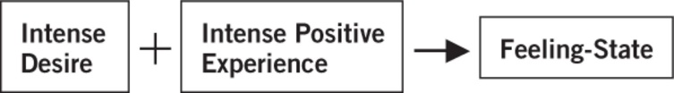

## Explanation

### **Biochemical: Dopamine**

* Rewarding stimuli such as stealing or gambling stimulates reward centres and releases dopamine.
* When behaviours become compulsive, you develop tolerance, and dopamine levels in the striatum reduce.
  * Striatum is responsible for the reward and behavioural control.
  * A deficiency of dopamine in the striatum leads to the continuation of compulsions and addictions, increasing stealing behaviours.
    * This is known as ‘**Reward deficiency syndrome’ (Comings &
      Blum, 2000) and** can be used to explain other forms of
      addiction.
* Kleptomania is a possible side effect of using synthetic dopamine
  for treatment of disorders such as Parkinson’s.
* Evidence shows that symptoms of gambling disorder and compulsive shopping emerge alongside the use of dopamine drugs, proving the relationship between dopamine and impulse control disorders.

### **Behavioural: Positive Reinforcement**

* When you receive a reward for doing a certain activity, you tend to repeat the activity to achieve more rewards – this is positive reinforcement; it occurs when learned behaviour results from previous trials.
  * E.g. the enjoyment gained by winning in poker
* **Gamblers don’t stop playing once they start losing because of
  Schedules of reinforcement.**
  * Gamblers don’t win every time they play, and so don’t feel 100% satisfied. Thus, they continue to play repeatedly, believing that playing just one more time will make up for the loss/lead to victory. This is **partial reinforcement.**

### **Cognitive: Feeling-State Theory (Miller, 2010)**

* **Miller explains how positive feelings can be linked to behaviours like gambling. The ‘feeling state theory’ proposes how underlying thoughts about such behaviours can then lead to obsession.**
* ICD can be created because the links form a ‘state-dependent memory’ known as the feeling state.

  Feeling states are created by an intense desire to do an activity, the positive experience associated with it (psycho-physiological arousal), and the memory of the behaviour.
  * A pyromaniac who has feelings stating ‘I am powerful’, combined with positive emotions, physiological arousal and memory of setting the fire, leads to compulsions of fire-setting behaviour.
* Underlying negative thoughts or experiences are the most likely cause of the feeling states that lead to impulse control disorders.
  * For example, the pyromaniac with the feeling-state ‘I am powerful’ when setting a fire may have an underlying set of negative beliefs (e.g., I’m weak), making the act more intense and desirable.
* Further negative beliefs occur when behaviour becomes out of control, such as gambling, stealing, etc, and have negative consequences for the individual and those around them.
* **Note:** normal behaviours in moderation only become problematic
  because of fixated, intense feeling-states.

| **Belief type** | **Example of belief** |
|----|----|
| Negative belief about oneself or the world | ‘I’m a loser’ |
| Positive belief created during the event (e.g. gambling) | ‘I’m a winner’ |
| Negative beliefs created from out-of-control behaviour | ‘I mess up everything’ |

**Issues and debates**

* **Application to everyday life** to treat addictive behaviours; understating the role of dopamine has led to biochemical treatments.
* **Individual versus situational debate**
  * **Biochemical explanation relates to individual impairment of
    brain function.**
  * **Cognitive explanation is more balanced: naturally, experiences
    will be stimulating/rewarding/upsetting, but as individuals, we
    develop our own feeling-states in relation to the experiences,
    leading to overall change in patterns of behaviour.**
* **Nature versus nurture debate:**
  * The behaviourist approach to positive reinforcement (Skinner, 1938) is based on nurture factors. The satisfaction gained from compulsive behaviours (in the environment) reinforces subsequent behaviour.
  * The biological approach (effect of dopamine uptake) is based on nature factors.

