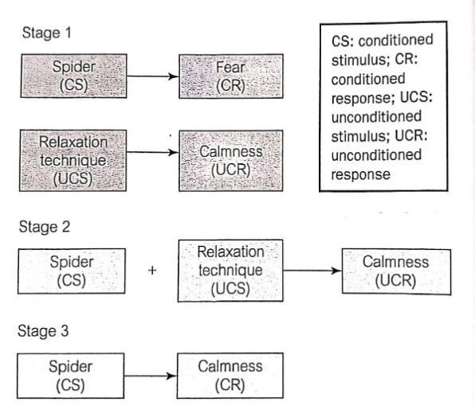

## Treatment and Management

### **Systematic Desensitisation (Wolpe, 1958)**

* It is a way of reducing undesirable responses to a particular
  situation.
* It holds the assumption that nearly all behaviour is a conditional
  response to stimuli in the environment.
* If a phobia can be learned, it can be unlearned.
* Systematically desensitising a patient requires that once the frightening stimulus should eventually become neutral and provoke no anxiety.
* **Reciprocal inhibition:** the impossibility of feeling two strong
  and opposing emotions simultaneously.
* The key to unlearning phobic reactions through SD is to put the fearful feelings associated with phobic stimulus directly in conflict with feelings of deep relaxation.
* **Stages in SD:**
  * **Teach patient relaxation techniques:** progressive muscle
    relaxation exercises, visualisation or even anti-anxiety drugs.
  * **Creating an anxiety hierarchy:** a list of anxiety-provoking situations in relation to specific phobias that increase in severity.
    * The patient works through each hierarchy stage via in vivo (direct) or in vitro (imagined) exposures.

|**Stage**|**Situation relating to Spider Phobia**|
|:---|:---|
|1|Looking at a drawing of a spider|
|2|Looking at a detailed photo of a spider|
|3|Watching a spider making a web on a video|
|4|Being in the same room as a spider|
|5|Standing in front of a spider’s cage|
|6|Standing next to another person holding a spider|
|7|Touching a spider whilst someone else holds it|
|8|Holding a spider in their own hand|

* At each stage of the hierarchy, the patient is assisted to remain calm and relaxed using their chosen technique. The patient does not proceed to the next stage until they report no feeling of anxiety in the current stage.

**Principles of Classical Conditioning Linked to SD**

* As both feelings of fear and calm are incompatible, a fearful response to a stimulus is unlearned, and no more anxiety is produced.
* Good evidence supports the effectiveness of SD in agoraphobia and fear of snakes, however treatments involving more direct forms of exposure is now more commonly used.

### **Applied Tension (Ost et al., 1989)**

* Involves applying tension to muscles to increase blood pressure
  throughout certain areas.
* **For example** blood phobia is associated with drops in blood pressure and, consequently, fainting. Using increased muscle tension, blood pressure can be raised, and fainting prevented

**In a study by Ost et al.:**

* **Sample:**
  * 30 patients (19M:11F) from the same hospital with a phobia of blood, wounds and injuries
  * 18-60 years
  * Using an independent design, they were divided into 3 groups: Applied tension, applied relaxation or a combination
* **Aim:** establish which treatment was the most effective, including
  applied tension.
* **Procedure:** participants were part of either group below and
  underwent the following 45-60 min sessions:
  * **Applied tension group:** 5 sessions
    * Participants learned to tense their arm, chest, and leg muscles until they experienced a feeling of warmth rising to their face. Once mastered, they would practice it during exposure to several blood-related situations.
  * **Applied relaxation group:** 9 sessions.
    * The applied relaxation technique involved progressive muscle relaxation during exposure to the same stimuli.
  * **Combined group:** 10 sessions.
  * **Before treatment**:
    * Participants were assessed by self-report, along with
      behavioural and physiological measures to establish
      tendencies towards anxiety and fainting.
    * This included being observed while watching videos involving surgical operations and having their heart rate and blood pressure measured.
* **Results:** After treatment and 6 months post-treatment, participants were given the same set of measures to establish any changes
  * **Across all groups:** 73% of participants showed a noticeable
    improvement in behavioural and physiological responses to blood.
  * **Applied tension:** As effective as other forms of treatment in **half the time**, it was, therefore, the most appropriate treatment for haemophobia.

### **Cognitive-Behavioural Therapy (Ost and Westling, 1995)**

* CBT considers the need to change an individual’s thoughts and beliefs about the source of their anxiety.

**In the study by Ost and Westling**

* **Aim:** compare the effectiveness of CBT with applied relaxation (AR) in patients with panic disorder (characterised by spontaneous/unexpected panic attacks)
* **Sample**:
  * 38 patients were recruited via newspaper advertisement and
    psychiatrist referrals.
  * They were treated individually across 12 weekly sessions.
  * They were assessed before, after and in a one-year follow-up by
    a self-report scale and self-observations of panic attacks which
    included noting panic attacks and their severity in a diary.
* **Procedure:**
  * **Steps in CBT:**

    1. Identifying the misinterpretation of bodily sensations i.e. thinking that when the heart beats fast, they are having a heart attack
    2. Participants were encouraged to generate alternative,
       non-catastrophic interpretations of their bodily sensations.
    3. The therapist challenged the patient’s evidence for their
       beliefs.

  * **Steps in AR:** progressive muscle relaxation techniques were taught, which were then practised in both panic and non-panic situations.
* **Results:** no significant difference nor relapse between AR and CBT, suggesting both methods were successful in short to medium-term alleviation of panic attack symptoms.

**Evaluation**

* **A study by Ost et al. (1989)**:

  * The sample was from the same hospital, limiting **generalisability**
  * Both sexes were part of the sample so that results could be applied to both
  * An **independent measures design** was used; thus, **participant variables** could have affected the outcome, reducing the validity
  * **Ethical issue:** although consent was given, participants were exposed to surgical procedures, which caused **distress**

* **A study by Ost and Westling (1995)**:

  * **More ethical** as participants kept diaries of naturally occurring panic attacks instead of triggering it
  * Well-controlled as therapists were given standardised training, increasing validity and removing **extraneous variables**
  * One-year follow-up shows a long-term effect of treatment rather than a 6-month follow-up in **Ost et al. (1989)**

* **A study Chapman and DeLapp (2013)**:

  * Strength: High validity through data triangulation (using qualitative background interviews alongside quantitative metrics like BAI and BISS scales).

  * Weakness: Low generalizability as it is a single case study ($N=1$). T's unique motivation regarding his child may mean the rapid success rate cannot be generalized to all haemophobic patients.

### Treatment Case Study: CBT and Applied Tension (Chapman and DeLapp, 2013)

* **Aim:** To evaluate the effectiveness of combining Cognitive Behavioral Therapy (CBT) with Applied Muscle Tension (AMT) to treat a patient with severe Blood-Injection-Injury (BII) phobia (Haemophobia).

* **The Sample (T):** A 42-year-old male who suffered from a severe fainting response (vasovagal syncope) when exposed to needles, blood draws, and medical environments. His motivation for treatment was high because his phobia prevented him from taking his child (who had Autism Spectrum Disorder) to necessary medical appointments.

* **Procedure (9 Sessions):**

  * Cognitive Stage: T received psychoeducation about how blood pressure drops during a vasovagal response and used cognitive restructuring to identify and challenge panic-inducing thoughts.

  * Behavioral Stage: T was taught Applied Muscle Tension (AMT)—tensing major muscle groups to artificially raise his blood pressure and prevent fainting.

  * Exposure Stage: T developed a 0–100 SUDS (Subjective Units of Discomfort Scale) hierarchy and systematically progressed from digital exposures (watching phlebotomy videos) to *in vivo* exposure (receiving an actual blood draw) while using AMT.

* **Results:** Post-treatment psychometric scales (BAI, BISS, and BDI) showed a drastic drop in anxiety and fainting symptoms. Follow-ups at 4, 10, and 12 months confirmed the long-term success of the combined therapy; T successfully attended medical appointments without fainting.

**Issues and Debates**

* Treatments apply **to real life** and are the most effective treatment found, e.g. applied tension was more effective for hemophobia than AR, reducing waiting times for therapy
* It provides clinical evidence that a holistic treatment matching behavioral physical counter-measures (AMT) with cognitive reframing (CBT) is highly effective for specific physiological phobias.
* **Nature vs Nurture**
  * In the case of SD, behaviourists assume that individuals are born (nature) a **‘blank state’** with few specific behaviour tendencies, and further behaviours such as phobia are developed via classical conditioning (nurture)
  * However, not all phobias develop from negative associations with traumatic events. Some are believed to have served an evolutionary purpose (nurture).
  * Thus, systematic desensitisation and other behavioural treatments are most effective for phobias that are learned.