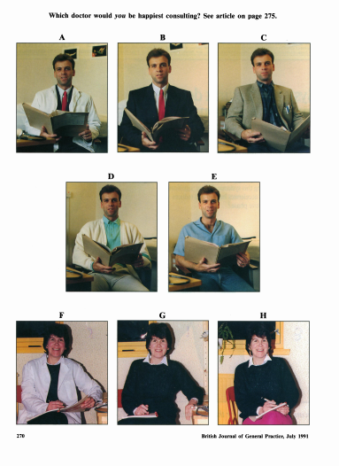

# The Patient-Practitioner Relationship

## Practitioner and Patient Interpersonal skills

### **Non-Verbal Communication (Mckinstry & Wang, 1990)**

* Investigated the role of practitioner’s appearance as a form of
  non-verbal communication
* A total of 475 patients seeing 30 doctors from five general medical centres in Scotland were recruited

### **Procedure:** 

* Interviews were given to the participants regarding
  their opinions on eight photographs

* The photographs consist of five male doctors and three female
  doctors, wearing different attire  

* They were asked:

  * *Which doctor they would feel happiest seeing for the first time (0-5 rating scale)*
  * *Whether they would have more confidence in the ability of one of these doctors*
  * *Whether they would be unhappy about consulting any of them*
  * *Which doctor looked most like their own doctor*

* Participants were also asked general questions about doctor’s attire

* The interviewer sampled patients at different times of day in five occasions at each surgery, seeing an average of over **70%** of
  available patients

### **Results:**

* Patients significantly **preferred male doctors wearing formal suit and tie**
* Patients also preferred **female doctors** wearing white lab **coat**
* **Older patients**, as well as **higher-class patients,** preferred **traditionally dressed doctors**
* **28%** reported that they would be unhappy seeing informally
  dressed doctors
* Some patients also **disliked** their doctor wearing white **lab coat**
* **64%** of patients said that the **way their doctor dresses**
  was **quite or very important**
* **Female doctors** received **higher ratings** than **male
  doctors**
* **41%** of patients were **confident** about **the formally
  dressed doctor’s ability**
* Mckinstry and Wang observed that it would have been useful to
  include a female doctor in a formal suit
* This has been included in the preference for the female in the white coat might not have been so apparent

### **Verbal Communication (Mckinlay, 1975; Ley, 1988)**

* Investigated the communication barriers between patients and doctors
* Specifically focused on doctor-based errors, which can have methodological flaws, such as not using independent raters

**Mckinlay (1975)**

* Conducted a pilot study into the words which the doctors
  used in a Scottish maternity hospital
* These words were classified as commonly used among patients,
  incomprehensible to patients or in between these two
  brackets
* Of the 57 words tested, only 13 fell into the middle bracket
* These 13 words became the focus of the study as they
  represented the ‘gray area’ of verbal comprehension
* Participants were interviewed to test their understanding of
  the words
* They were asked to read the word and hear it being used in a sentence and were asked to define the word
* Patients’ responses were verbatim on a standard identified
  by the patient’s number and then scored by two independent
  doctors (male and female)
* These scorers were working ‘blind.’
* They were unaware of individual participants or the other
  doctor’s score
* One year after data collection, the group of doctors working
  on the ward were asked to indicate the words’ level of
  understanding they would expect for a typical patient to
  have for each word
* The scale used ranged from A (not understand at all) to D (understand pretty well)
* The scorers were reliable, giving the same or similar
  ratings
* In the scores obtained, patients who underused the medical services were less likely to have an adequate understanding of the words in comparison to regular users
* Regular users had worse comprehension for ‘navel’ and
  ‘rhesus’
* Women who had at least one child were slightly more likely
  to comprehend words than those attending the hospital in
  their first pregnancy
* Only for ‘purgative’ was the women’s comprehension score
  lower in both groups
* The women did have some knowledge, such as claiming that
  ‘rhesus’ was about ‘your blood group’ which was not deemed
  to be an adequate understanding

**Ley (1988)**

* Reported on the frequency at which patients forget the
  verbal advice given to them by doctors
* This forgetting is linked to several factors, such as the amount, order, perceived importance and nature of the information given
* Age, anxiety and medical knowledge also contributed to
  forgetfulness
* To improve relationships, Ley suggested that a practitioner must use **simple language**, **state the essential information first, advise** and **repeats the key points**

### Evaluation:

* Mckinstry and Wang
  * This study utilized a **wide representative sample** from
    different doctors and clinics.
  * This reduces **demand characteristics**, as shown by the fact
    that some patients claimed that the doctor’s attire was not
    important.
  * However, if a photograph of a **female doctor in a formal suit**
    was part of the choices, the preference for the female doctor in
    the white coat to be less apparent
  * There could be pressure for women to **conform to a
    stereotype**, for example, there were more objections towards a
    female in jeans over a male.
* Mckinlay
  * The usage of **blind scorers** and **clear interviews** ensured
    the **validity** of the data gathered
  * The procedure is also **standardized**, which can increase
    **reliability**
  * The interview assured that only the doctors would be “tested”, this ensured that participants are not **psychologically harmed** by **being reassured**
* Ley
  * Ley’s proposals have **great application** in improving doctors’ practices

### Issues and Debates:

* General
  * Doctor’s beliefs will have a **deterministic effect** on
    patients’ behaviour
  * By underestimating their comprehension, doctors may bring a
    situation at patients may have a hard time understanding
* Mckinlay
  * Mckinlay’s findings have **great application to everyday life**, suggesting that doctors should use understandable terminology to their patients, as some patients, may not understand some terms
  * This study also displays **individual and situational**
    explanations as there are **individual differences** in the
    patient’s knowledge, as well as **situational factors** that the
    doctors may expect when consulting with patients
* Mckinstry and Wang
  * Mckinstry and Wang’s findings show **individual and
    situational** explanations, as some patients may have individual
    preferences on their doctor’s attire