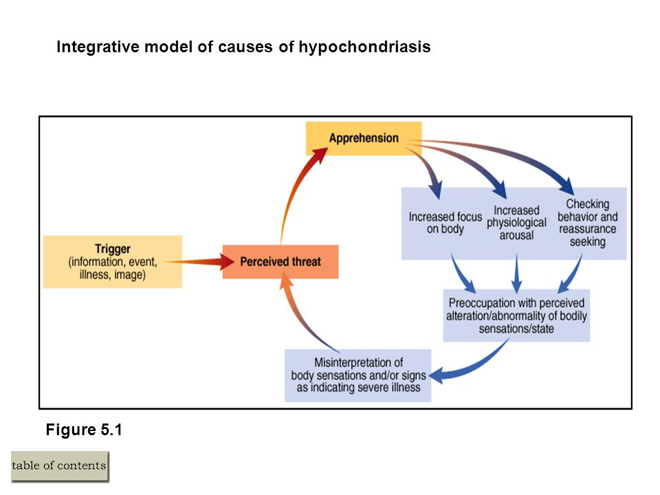

## Misuse of Health Services

Patients may sometimes misinterpret their illnesses delay their treatment, or seek medical advice. This section will also deal with two disorders: hypochondriasis (a fear of illness) and Munchausen syndrome.

### **Delaying Treatment (Safer et al., 1979)**

* Investigated the likely factors that can influence delays in seeking
  medical treatment
* Conducted a study in waiting rooms of four clinics in a large inner-city hospital
* Interviewers approached patients waiting for a doctor or nurse
* They were asked if they were going to tell the doctor about a new
  symptom
* If the patient was presenting new symptoms, they were asked to take part in the study
* 93 patients (38 males, 55 females) with an average age of 44 years were interviewed
* They were asked about their symptoms and their reactions to the
  symptoms, as well as the length of their delay
* The interview lasted for 45 minutes
* Safer et al. identified three stages of delay:
  * **Appraisal Delay** – defined as the number of days that elapsed from the day the patient first noticed their symptom up till the day that they concluded they were ill
  * **Illness Delay** – the time it takes between realizing that
    patient is ill and deciding to seek medical advice
  * **Utilisation Delay** – the time it takes between seeking
    medical advice and actually doing so

### **Misuse: Hypochondriasis (Barlow & Durand, 1995)**

* Persistent fear of serious medical illnesses
* People with this disorder believe that normal sensations or minor symptoms as a sign of illness with a negative outcome
* For example, a person may fear that perspiring can lead to heart
  attack
* It is often accompanied by several mental illnesses, such as obsessive-compulsive disorder, phobias and somatisation disorder
* Hypochondriasis is a chronic illness that can begin at any time of a
  person’s life, especially within the age range of 20 to 40 years
* Despite being classified as a somatoform disorder

 

### **Munchausen Syndrome (Aleem & Ajarim, 1995)**

* Characterised as physical or psychological symptoms that are
  intentionally produced in order to assume sick role
* Named after Baron Munchausen, a famous German aristocrat, known for
  telling unbelievable tales of his exploits
* People with this condition intentionally produce or pretend to have
  physical or psychological symptoms of an illness
* Their main intention is to play sick and have others care for them
* Patients suffering from Munchausen Syndrome may spend years going
  from one doctor to another while pretending to have an illness
* They may pretend to have psychological symptoms (hearing voices),
  physical symptoms (pain and aches), or try to make themselves ill by
  infecting themselves
* There are four ways in which these patients behave:

<!-- end list -->

* Lying about symptoms
* Tampering results
* Self-infliction (cutting or burning)
* Aggravating pre-existing symptoms

#### **Aleem and Ajarim (1995)**

* Case study of a 22-year-old female university student who was
  referred with painful swelling over the right breast
* From the age of 17, she had been seen by hospitals regularly for
  issues relating to her menstrual cycles
* She developed symptoms similar to deep vein thrombosis and was
  referred to medications, which did not work
* Soon after the swelling, she reported swelling in her groin area
* Following physical examinations and investigations, she was
  diagnosed with hematoma
* She was treated with antibiotics, but surgical drainages were needed
  as she developed abscesses
* At this stage, doctors were suspicious of the cause of abscesses
* Upon finding a syringe with faecal matter, the woman was confronted
  and left the hospital angrily

#### Evaluation

* Delaying Treatment
  * Safer’s study uses **self-reports** to explain why patients
    delay their treatment. There are issues with **validity** as
    patients can answer desirably
  * The **sample** used in this study is large and represents both male and female populations. This has high **population validity,** which can allow the researcher to generalize the findings to the general population

#### **Issues and Debates:**

* Delaying treatment
  * Safer et al.’s findings have good **application in everyday life** as practitioners can put interventions to stop such delays
* Hypochondriasis
  * Understanding hypochondriasis can further support the
    **development of treatment programmes** that can reduce the
    number of times a patient presents himself to a medical check-up
  * This **reduces costs** and prioritizes those who really need
    medical attention
* For both Hypochondriasis and Munchausen Syndrome
  * Mental illnesses such as Hypochondriasis and Munchausen Syndrome
    may have **individual and situational explanations** towards their origin. For example, there have been suggestions stating that childhood trauma, as well as personality disorders, may cause these illnesses.
  * The **Nature versus nurture** debate is also considered as there could be biological and psychological triggers (e.g. hormone release) to these illnesses
  * Majority of research on hypochondriasis and Munchausen Syndrome
    have been conducted on Western patients, which can lead into
    **cultural bias** in understanding these disorders and the
    development of these treatment programmes.

