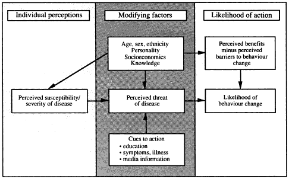

## Types of Non-Adherence and Why Patients Don’t Adhere

There are many reasons why patients cannot always adhere to medical advice. Non-adherence can fall into two categories: patient-based and doctor-based behaviours.

### **Types of Non-Adherence and Problems Caused by Non-Adherence**

* Non-adherence to medication is a complex healthcare problem.
* The causes can be related to the patient, treatment and the type of
  health care provided
* As a consequence, patients do not benefit from correct diagnosis and
  treatment, increasing **morbidity** and **mortality**
  * **Morbidity:** incidence of disease across a population
  * **Mortality:** rate of death in a population
* Here are some possible ways that a patient may not adhere to medical
  requests

|**Before treatment**|Poor description of the treatment programme|
|:---|:---|
|**During treatment**|Takes more or less of a drug than has been prescribed|
||Take the drug at a different time than instructed|
||May not complete prescription|
||Only attend some clinics and follow-up appointments.|
||Not completing exercises (physical therapies)|
|**After treatment**|May end their course of treatment early or fail to attend sessions|
||May revert straight back to behaviours that were changed through the treatment|

* Non-adherence can also be influenced by the patient’s context of the
  treatment provided.

|**Patient**|Decides that they don’t need treatment.|
|:---|:---|
||The patient does not understand the treatment.|
||The patient decides the cost of treatment is more than the benefits.|
||Social support and demographic factors|
|**Treatment programme**|The treatment programme is time-consuming and expensive|
||Access to treatment programmes is not easy|
|**Health care provider**|The doctor does not stress the importance of treatment|
||The doctor does not give adequate details on how to administer the drug|

### **Rational Non-Adherence (Bulpitt, 1994)**

* Rational Choice Theory is a framework for understanding and modelling why an individual will behave in a particular way
  * **Rational:** based on or in accordance with reason or logic
* Claims that people weigh the costs and benefits of a certain
  treatment
* If costs are higher than benefits, an individual would not change their behaviour to adhere to medical requests
* **Bulpitt (1994)** reviewed several studies involving a cost-benefit
  analysis when deciding on the course of action that patients would
  take
* Drug treatment for hypertension in elderly patients was considered
  by the researcher
* Found that both the **EWPHE** AND **SHEP** studies had many health risks to drug treatment in the elderly, such as gout, changes in bowel movements and chest pain
* The **MRC** trial for elderly patients found that coronary events
  reduced by 44% with a mixture of prescribed drugs
* Bulpitt concluded that the benefits of treating combined systolic and diastolic hypertension in elderly patients outweigh the disadvantages
* When considering the benefits of antihypertensive treatment, it is
  important to consider benefits other than stroke reduction
* He also referred to the difficulty in measuring cost-benefit
  interactions in individuals

### **Health Belief Model (Becker and Rosenstock, 1974)**

* It aims to predict when a person will engage in preventive health behaviours
* The likelihood that individuals will follow medical advice depends
  on two assessments that they make: evaluating the threat and a
  cost-benefit analysis
* When evaluating a threat, several factors can influence a person’s perceived threat of illness, including:
  * Perceived Seriousness
  * Perceived Susceptibility
  * Cues to Action
* The cost-benefit analysis looks at whether the perceived benefits
  exceed the perceived costs
* The barriers may include:
  * Financial (e.g. prescription charges are too expensive)
  * Situational (e.g. difficult-to-access clinic)
  * Social (e.g. don’t want to face ageing)
* Benefits can include:
  * Improved Health
  * Relief from anxiety
  * Reducing health risk

‎   ‎

* In 1974, Becker developed the **Compliance Model**, building heavily
  on the Health Belief Model
* It was used to explain why a patient might comply with medical
  requests
* The model can predict factors that would influence the likelihood of a patient adhering to a medical request
* Perceptions of the patient’s mother are examined as it was believed that the mother would usually be the one who will decide on whether the child is sick or not
* The Compliance Model introduces the concept of health motivation
* It considers both negative (physical threat) and positive aspects (awareness of health concerns)
* The second concept introduced is that of the incentive value of adherence
* These are factors about the illness that contribute to the decision to adhere, such as the child’s vulnerability and the degree of harm
* This model is supported by a study conducted in 1971 where a random
  sample of 125 cases were drawn from a population of children being
  treated in the Comprehensive Child Care Clinic at a large teaching
  hospital
* The children were aged from six weeks to ten years and were all placed on a course of liquid oral antibiotics and a follow-up visit
* An hour-long interview was conducted with each patient after the
  doctor’s appointment
* Adherence was **operationalised** by asking the name of the
  medication, the number of times a day it should be given and the
  date of flow-up appointment
* The results showed that mothers who adhered to various aspects of
  prescribed treatment were more interested in their child’s health
  and were concerned about the present illness
* They perceived illness as a substantial threat to the child but had confidence in the physician’s ability and medication to reduce the threat

<!-- end list -->

**Issues and Debates:**

* **Individual-Situational Debate:** reasons why patients could not adhere may vary between individual and situational explanations
  * Situational explanations would often revolve around environmental factors that can affect adherence, such as levels of education, income and family networks
  * Individual factors put more emphasis on personality factors of the individual, as well as a cost-benefit analysis
* **Applications to everyday life**:
  * Doctors can use these reasons to stress the patient’s gains
    by following the medical advice by reducing the costs
* **Cultural Bias**
  * There can be different factors exclusive to other countries
    that can affect adherence to medication (e.g. economic
    status)