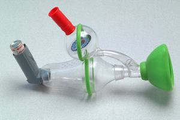

## Improving Adherence

### **Improving Adherence (Ley, 1988; Atreja et al., 2005)**

* Reviewed a selection of studies of practitioners and hospital
  patients
* Found that 28% of patients in the UK had low satisfaction ratings of
  the treatments they received
* Dissatisfaction was even higher in hospital patients, with 41%
  giving low satisfaction ratings of their treatment
* Ley suggested that patients are “information seekers” who want to
  know the details of the treatment and their disorders
* He suggested that dissatisfaction came from a lack of emotional
  support, as well as the doctor’s understanding, lack of information
  when prescribing drugs or the failure to explain the patient’s
  disorder
* The more information the patient receives, the more that he can be
  satisfied
* Despite research on non-adherence being conducted, there were no
  reported changes in adherence level.

<!-- end list -->

* **Atreja et al. (2005)** reviewed the current literature regarding adherence and developed the **SIMPLE** mnemonic that brings all the
  elements of successful adherence methods that an intervention should
  have
  * **S**implifying regimen characteristics
  * **I**mparting knowledge
  * **M**odifying patient beliefs
  * **P**atient and family communication
  * **L**eaving the bias
  * **E**valuating adherence

### **Behavioural Techniques**

* Behavioural techniques can be used to increase adherence to
  medications.
* These techniques, according to behaviourists, offer a number of suggestions to improve adherence, such as changing habits using classical conditioning, positive reinforcement to encourage positive behaviours, and using role models to show the importance of adherence to medical requests

**Monetary Incentives (Yokley & Glenwick, 1984)**

* Evaluated the impact of four conditions for motivating parents
  to take their children to be immunized
* These conditions include:
  * **Mailed General Prompt (n = 195)**
  * **Specific Prompt (n = 190):** received a personalized
    message containing the exact details of the immunizations
    the child needed
  * **Increased access (n = 185):** received the specific prompt
    and a second page that included the mention of two off-hours
    clinics being opened
  * **Monetary Incentive (n = 183):** received the specific
    prompt with a second page that opened with the mention of a
    raffle with a $175 prize
* This condition received a lottery ticket at the end of the mail.
* Parents in this condition were told how to join the lottery that provided 3 prize pools, worth $25, $50 and $100
* The impact of the different prompts was measured over the following 12 weeks to assess how many of each group would attend the immunization
* Results show that the monetary incentive condition had the biggest impact on attendance, followed by increased access, specific prompts and general prompt groups, respectively
* It appears that monetary incentives provide immediate adherence,
  but specific prompts were a cost-effective option

**Funhaler (Watt et al., 2003)**

* Making children’s medical treatments “fun” can have positive consequences on adherence
* Watt et al. stated that poor adherence to prescribed frequency remains a major problem for paediatric asthmatics on inhalers
* They wanted to investigate the effectiveness of the “Funhaler”
  as a form of adherence to child asthmatics
* The Funhaler consisted of several features that distract
  children’s attention from the drug delivery and a form of
  self-reinforcement through the use of effective breathing
  techniques
* These distractions can include a whistle and a spinner that activates as the child breathes
* 32 Australian children participated in this study and were
  either given the Breath-a-tech inhaler for a week and the
  Funhaler for the second week
* 38% more patients were found to have medicated their children
  the previous day with the Funhaler
* 60% more patients took the recommended four or more cycles of
  aerosol delivery when using the Funhaler

‎  ‎

An image of the Funhaler used in Watt et al. (2003)

* These studies display the effectiveness of behavioural techniques
  that can be used to increase adherence.

<!-- end list -->

### **Issues and Debates:**

* **Practical Applications:**
  * The concepts and theories discussed have good application to
    doctors
* **Longitudinal Research:** Yokley & Glenwick’s study takes **a longitudinal approach** to research to studying adherence to medical requests. This allows researchers to see the impact of an intervention over a long period of time.
* **Usage of children:** Watt et al. illustrate how psychological reinforcers in the form of turning an inhaler into a fun experience can improve the child’s use of their inhalers

### **Evaluation:**

* Yokley & Glenwick’s study was conducted on a **large sample**. This gives out a high population of validity
* Yokley & Glenwick’s study participants may also bring ethical concerns about **informed consent** and **deception**.
* As the researchers asked parents to come in an actual setting, this can give ecological validity and can be generalized to other populations.