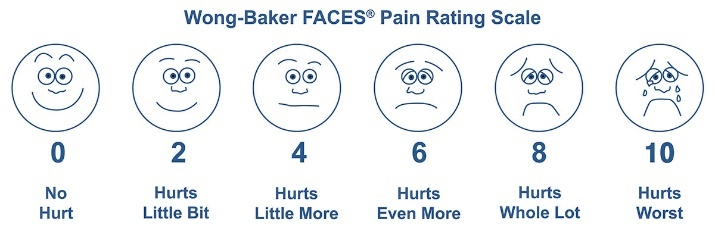

## Pain Measures for Children

### Pediatric Pain Questionnaire (Varni and Thompson, 1987)

- The PPQ is a multidimensional questionnaire for assessing childhood
  pain, with separate forms for the child, parents and doctor

- This questionnaire is heavily based on McGill Pain Questionnaire and
  assesses the perceptions of patient’s pain experience in a
  child-friendly format

- Children are first asked to encircle words that best describe their
  pain and must choose three words that best describe the experience
  of their pain

- The child was also asked to rate how they feel at the time on a
  continuum as well as rating the worse pain they had on the same
  scale

- Finally, they are asked to pick four colours to mark the severity of
  pain and colour the part of their body that hurts depending on their
  colours picked

### Wong-Baker Scale

- Uses six faces to measure pain

- The faces ranged from 0 (no hurt) to 10 (hurts worst)\
  

<!-- end list -->

- **Garra et al (2010)** were able to demonstrate significant
  difference in the visual analogue scale for each of the Wong-Baker
  FACES Scale

- The visual analogue scale was found to have an excellent correlation
  in older children with acute pain and had a uniformly increasing
  relationship with Wong-Baker FACES Scale

<!-- end list -->

### **Issues and Debates:**

- Specificity theory is reductionist, as it only explains the
  source of pain biologically

- All theories of pain have good applications to everyday life as
  they can help practitioners understand why we perceive pain and
  develop treatment programmes that can help patients