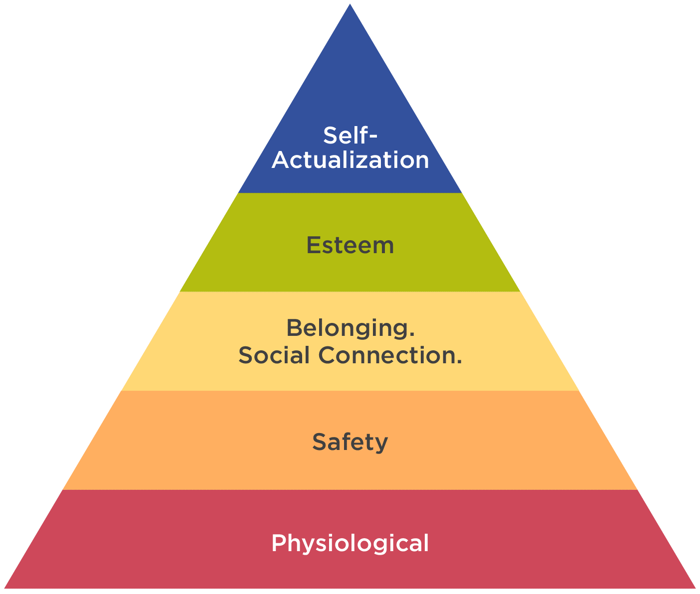
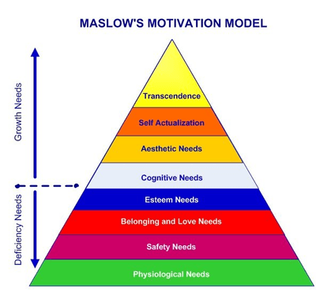

# Motivation to Work

## Need Theories

### **Hierarchy of Needs (Maslow, 1970)**

* All needs can be arranged in a hierarchy- you move up as you fulfil each level, starting with basic physiological needs.
* **Maslow’s Original Hierarchy of Needs (1943):**

 

* **The Updated Model (1970) has 8 stages:**
  * **Biological and physiological needs:** basic survival needs: air, shelter, water, food, sleep, and sex.
  * **Safety needs** a stable society with appropriate legal and justice systems.
  * **Love and belongingness needs** include work, family, friends, and romantic relationships.
  * **Esteem needs** refer to achievements: skills, status, independence, etc. Some feel a sense of esteem through their family roles, well-paid jobs, voluntary work or the creation of something that receives critical acclaim.
  * **Cognitive needs:** relates to our need for information, knowledge and meaning.
  * **Aesthetic needs:** our need and appreciation of beauty.
  * **Self-Actualisation:** reaching our potential and becoming fulfilled.
  * **Transcendence Needs:** our ability to help others and also to achieve self-actualisation. 

### **ERG Theory (Alderfer, 1972)**

* **Revision of Maslow’s simplifies into 3:**
  * **Existence Needs:** basic survival needs such as physiological and safety needs.
  * **Relatedness Needs:** social and self-esteem needs. The latter is divided into:
    * Internal and external
    * The need for relatedness satisfies external self-esteem.
  * **Growth Needs:** self-development and advancement that match self-actualisation and self-esteem needs from Maslow’s hierarchy.
    * Satisfies internal element of self-esteem needs.
* It is not a hierarchical approach, and one can simultaneously be motivated by multiple needs.
* However, the importance of these needs might change throughout your life.
  * Relatedness needs may be most important in adolescence and early adulthood, followed by growth needs as we establish a career and then relatedness needs again when we start a family.

### **Achievement Motivation (McClelland, 1965)**

* According to McClelland, different needs motivate different people, and these differences are measurable.
* **The three types are:**
  * **Need for *achievement (N-Ach):*** need to get things done and succeed. These people are highly motivated by challenges and appraisals (feedback).
  * **Need for *affiliation (N-Affil):*** need to be liked by others, accepted, and put effort into developing and maintaining social relationships. They prefer to work with others and will be motivated by cooperative tasks.
  * **Need for *power (N-Pow):*** influence and control over others. They are motivated by the chance to gain status or prestige or to be looked up to by others.
* N-Ach can be measured by the **Thematic Apperception Test** or **TAT.**
  * These are a series of ambiguous images that an individual is asked to interpret.
* This theory falls under the projective personality test, which uses ambiguous stimuli such as ink blots or the Thematic Apperception Test.
  * The response is thought to reveal hidden emotions and conflicts which the individual projects onto his depiction of the image.
  * As it is subjective, it has low reliability and validity.

### **Evaluation**

* **Maslow’s Hierarchy of Needs:**
  * It’s difficult to support the belief that needs are arranged hierarchically. Hence, Alderfer’s approach may be more accurate.
  * Maslow’s self-actualisation has also been hard to test as it was based on a small number of people that he thought were ‘self-actualised’.
  * However, the theories of motivation can be applied to workplaces as the organisation tries to implement physiological, safety, social and self-esteem needs.
* **McClelland’s Theory** can also be applied in the workplace to help understand personal characteristics and to ensure that people are given roles that suit their particular need for achievement.

