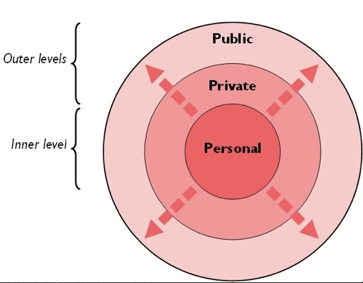

# Leadership and Management

## Traditional and Modern Theories of Leadership

### **Universalist and Behavioural Theories**

* **Universalist Theory:**
  * **Great Man Theory:** argues that leaders are born with leadership qualities, not made.
* **Behavioural Theory:** looks at specific behaviours rather than personal qualities. These behaviours are divided into two distinct categories:
  * **At Ohio State University:** Initiating Structure and Consideration
  * **At University of Michigan:** Task-oriented behaviours and relationship-oriented behaviours

|Initiating structure/**task oriented**|Consideration/**relationship-oriented**|
|:---|:---|
|Allocating tasks to people|Expressing concern for the feelings for and well-being of workers|
|Creating groups and defining goals||
|Setting deadlines/targets and ensuring they are met|Establishment of a rapport with workers|
|Monitoring and supervising progress|Spend time examining and understanding interpersonal skills between workers.|

### **Adaptive Leadership (Heifetz, 1997)**

* The need for change or adaptation when traditional forms of leadership are ineffective.
* Heifetz et al. defines leadership as ‘the art of mobilising people to tackle tough issues, adapt and thrive’.
* Rather than leading by providing solutions, having the management solve problems, and maintaining organisational norms – an adaptive leader must shift the responsibility for change to the entire workforce, such that employees may take new roles, learn new skills, align with new values or even leave the workforce.
* Adaptive leadership allows for disorientation, conflict and challenge to create a new organisation that can survive.

|**Traditional leadership**|**Adaptive leadership**|
|:---|:---|
|It is about authority and issuing directions to others|It is about helping others find their inner authority|
|It is about maintaining organisational norms and traditions|It is about challenging norms and traditions, exploring new ways of working|
|Makes use of skills and competencies available|Pushes boundaries in attempts to extend skills and competencies|
|It is useful in times of certainty|It is useful in times of uncertainty|
|It is about solutions or directions based on past experiences|It is about new solutions or directions that have not been explored, have unknown outcomes|

* **Key principles of adaptive leadership:**
  * **Get on the balcony:** seeing the entire picture, viewing the organisation and how it works as though observing from above.
  * **Identify the adaptive change:** Determine the nature and extent of adaptive change - be it organisational structure, values, working practices, or relationships.
  * **Regulate stress:** managing stress and pressure from adaptive change such that it is enough to motivate people to change but not so much that it overwhelms them. The adaptive leader must tolerate uncertainty and frustration whilst communicating confidence.
  * **Maintain disciplined attention:** being open to contrasting perspectives and confronting issues directly.
  * **Give the work back to the people:** Step back from the traditional role of telling. Instead, allow employees to use their special knowledge and recognise that they are best suited to identify solutions to problems.
  * **Protect voices of leadership from below:** giving voice to all people to learn of imminent challenges; silencing them can be fatal to the organisation.

### **Three Levels of Leadership (Scouller, 2011)**

* **Public Leadership:** behaviour required to influence groups of people
* **Private Leadership:** behaviours involved in influencing individuals.
* **Personal Leadership:** the inner level concerning leadership qualities shown by the individual, including skills, beliefs, emotions, subconscious behaviour and presence.
  * Leaders need to grow their leadership presence and know-how (procedural knowledge) by cultivating the right attitude towards others, working on psychological self-mastery, self-awareness, technical competence, and connecting with those around them.
  * Scouller argues that personal leadership is the most powerful of the three levels – the inner core and source of a leader’s outer effectiveness.

### **Evaluation**

* **Nature vs Nurture Debate:**
  * **Nature:** The Great Person Theory states leaders are born and not made.
  * **Nurture:** Scouller believes that leadership presence can be developed.
  * Heifetz et al. suggest leaders need to adapt and change and that leadership skills can be learned.
* **Individual vs Situational Debate:**
  * **Situational:** The 3Ps model and Adaptive leadership show that different skills will be required for different situations, e.g. trying to persuade an individual rather than a group. Heifetz et al. argue strongly for adaptive leadership in uncertain situations.
  * **Individual:** some individuals may be better qualified to provide adaptive leadership, and the extent to which personal leadership is developed differs per person.

**Research Methods:**

* Research conducted by Ohio State University and the University of Michigan's data collection from numerous organisations and individuals makes their findings generalisable.
* Heifetz et al. and Scouller present theoretical models of leadership.