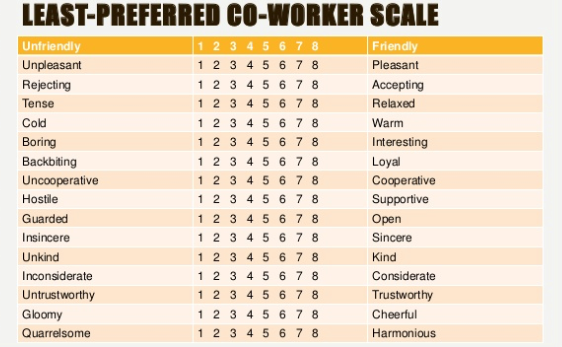
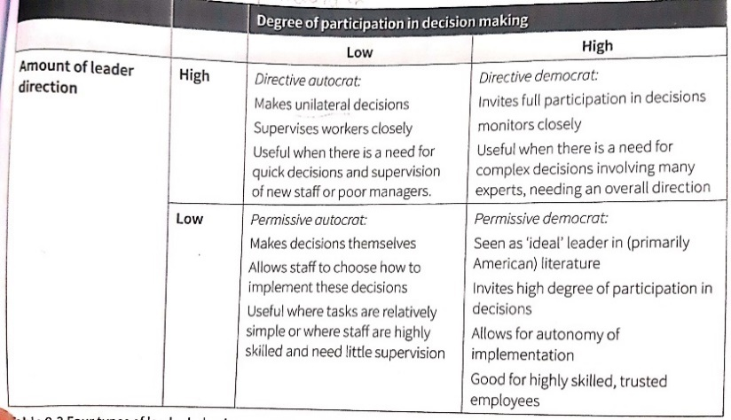

## Leadership Style

### **Effectiveness: Contingency Theory (Fiedler, 1967)**

* Different leadership styles will be effective in different situations.
* **Least preferred co-worker scale (LPC):**
  * A 16-item questionnaire asking leaders about the person they work least well with.
  * As everyone’s LPC is equally unpleasant, the scores indicate more about the test taker rather than their least preferred co-worker.
  * **Low LPC score:** task-oriented (harsh ratings)
  * **High LPC score:** relationship-oriented (positive ratings)

### **Situational Leadership (Hersey and Blanchard, 1988)**

* There’s no single effective leadership style - leaders may have their preferred styles, but they must adapt their style to suit the situation.

* The **situational leadership model** is dependent on leadership style and the individual/group’s maturity level. An effective leadership style must be relevant to the task and adapt to the maturity level of the group being led.

  * **Maturity:** capacity to set high but attainable goals, willingness and ability to take responsibility, relevant education and/or experience of an individual/group for the task.

  

### **Types of Leadership Style:**

* **Telling (directive leadership) (S1):** largely directing; the leader will define the roles for each member whilst explaining/telling them how, why, when and where to do the task.
* **Selling (S2):** directive but involves 2-way communication, along with relationship skills so that members ‘buy into’ or feel part of the process.
* **Participating (democratic leadership) (S3):** The leader provides less direction. However, there’s shared decision-making, along with high relationship skills.
* **Delegating (S4):** A leader is involved in the decision-making process, but responsibility is delegated to the group – the leader monitors rather than directs.

### **Levels of Maturity:**

* **M1:** The individual/group lack the specific skills required and is unable and unwilling to do or take responsibility for the task.
* **M2:** unable to take responsibility for the task but is willing to work at it. They are enthusiastic but need more training and support.
* **M3:** experienced and able to do the task but lack confidence or willingness to take on responsibility.
* **M4:** experienced and comfortable in their ability to do the task, along with taking responsibility for it.

||**M1**|**M2**|**M3**|**M4**|
|:---|:---|:---|:---|:---|
|**ABLE?**|No|No|Yes|Yes|
|**WILLING TO TAKE RESPONSIBILITY?**|No|Yes|No|Yes|
|**ENTHUSIASTIC?**|No|Yes|No|Yes|

### **Styles of Leader Behaviour (Muczyk and Reimann, 1987)**

* Muczyk and Reimann argue that democratic leadership is not always the most effective leadership style and may not work at all in some situations.
* The democratic style will only be effective if the followers are both willing and able to participate in the decision-making process.
* If they are not, the leader cannot be democratic without also being directive.
  * This is because despite having shared decision-making (participation), the **implementation** of the decision still needs to be directed to the people (directive).
* **This, therefore, produces 4 types of leadership behaviours –effective in certain situations–, which are:**

### **Evaluation**

* **Individual vs Situational debate**
  * **Fiedler** believes that different leadership styles will be effective in different situations.
  * **Hershey and Blanchard** believe that the leader must adapt to different situations, and the extent to which they are able to do this determines the success rate of the organisation.
  * **Muczyk and Reimann** highlight the applications and usefulness of styles of leader behaviour. They note that decision-making will be ineffective if it is not implemented.
  * Overall, for leaders to be effective, they need to adapt to different situations and groups.
* **LPC** **scale**
  * Ratings tell little about an individual’s leadership style
  * Prone to social desirability bias
  * Difficult to construct unbiased test
  * Tests may reveal more about the assumptions of the test maker
  * Relatively easy to administer and mark
  * Produces quantitative data that is easily analysed
  * An objective way to measure personality characteristic