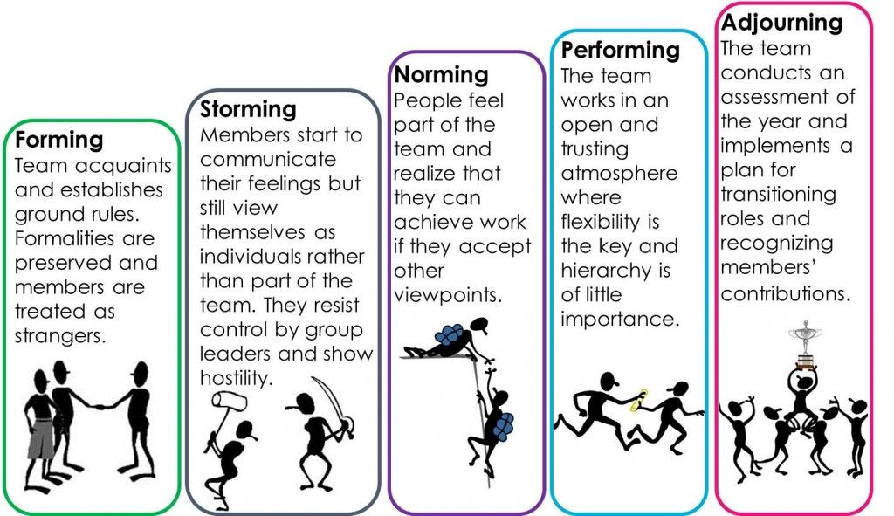
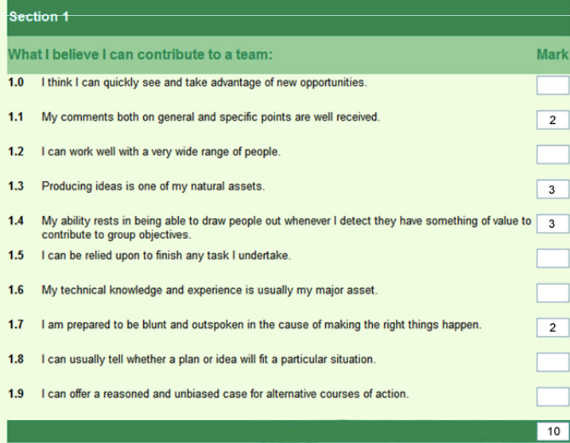

# Group Behaviour in Organisations

## Group Development and Roles

**Group development (Tuckman, 1965)**

Tuckman proposes that all groups go through the following 5 stages during their formation:

**Team roles (Belbin, 1981)**

Belbin proposes that an ideal team consists of people

who are prepared to take on different roles:

### **Action-oriented roles:**

* **Shapers:** challenge the team to improve
  * Dynamic, extroverted, and enjoy stimulating others
  * Question established views and find the best approach for solving problems
  * See obstacles as exciting challenges and thrive on pressure
  * **Weakness:** may be argumentative and upset colleagues
* **Implementers:** put ideas into actions
  * Turn the team’s ideas and concepts into practical actions and plans
  * Work systematically, efficiently and is organised
  * **Weakness:** can be inflexible and resistant to change
* **Complete-finishers:** ensure thorough, timely completion
  * Ensure there have been no mistakes and pay attention to the smallest of details
  * Strict with deadlines and make sure job is completed on time
  * **Weakness:** perfectionists who may worry unnecessarily and find it difficult to delegate

### **People-oriented roles:**

* **Coordinators:** act as chairperson
  * Guide the team to objectives and delegate tasks effectively
  * Excellent listeners, calm and good-natured
  * Quickly recognise the value of each member
  * **Weakness:** may delegate too much personal responsibility and may be manipulative
* **Team workers:** encourage cooperation
  * Prioritise team cohesion, and help members get along
  * Provide support and ensure effective teamwork
  * Are negotiators, flexible, diplomatic, and perceptive
  * **Weakness:** indecision and difficulty committing to a position
* **Resource investigators:** explore outside opportunities
  * Innovative, enthusiastic and curious
  * Explore available options, develop contacts and negotiate for resources on the team’s behalf
  * Work with external stakeholders to help team achieve objectives
  * They are extraverted, and people generally respond positively to them
  * **Weakness:** may lose enthusiasm quickly

### **Thought-oriented roles:**

* **Plants:** present new ideas and approaches
  * Creative, imaginative and can solve problems
  * Introverted, prefer to work on their own
  * **Weaknesses:**
    * Thrive on praise, struggle to take criticism
    * Sometimes impractical and poor communicators
* **Monitor evaluators:** analyse the options
  * Good at analysing and evaluating ideas proposed
  * Shewed, objective and strategic; carefully weigh pros and cons before making decisions
  * **Weakness:** may seem detached or unemotional
* **Specialists:** provide specialised skills
  * Dedicated, self-motivated and provide a rare set of knowledge and skills
  * **Weakness:** may focus on technicalities at the expense of the bigger picture, slowing the process

**Measuring team roles: Belbin team inventory**

* A paid self-report test for assessing team roles that produces a detailed report of your skills and abilities in relation to Belbin’s team roles e.g.
  * Advice on which role you must be most comfortable in
  * Roles you may be best/least suited
* **Note:** the inventory is split into 8 sections, where a total of 10 points need to be allocated per section e.g.

### **Evaluation**

* **Tuckman’s model:**
  * **Advantages:**
    * Provides guidance and understanding on how groups form and allow organisations to see what they go through is part of normal developmental process
  * **Disadvantages:**
    * Originally proposed as an explanation for small groups may not be useful for understanding larger groups
    * Timescale for moving from one stage to another not provided
    * Group formation is cyclical, not linear
    * Does not consider the differing team roles members might have to adopt
* **Belbin’s theory:**
  * **Advantages:**
    * Recognises need for diversity, characteristics and skill-sets within groups
    * Assesses preferred roles of members
    * Encourages all members to appreciate characteristics and strengths of others
    * Members in small groups will take more than one role (so not very reductionist)
  * **Disadvantages:**
    * Many management teams have too many implementers and shapers, and not enough plants and team workers \ plans may lack creativity and some members alienated.
* **Belbin’s inventory:**
  * **Advantages:**
    * Has real-life application as it can be used to identify the person best suited for a particular task based on his skills/role. This will increase work satisfaction and productivity.
    * Can identify the hiring needs of an organisation
  * **Disadvantages:**
    * As it is a self-report, there is a risk of social desirability reducing validity.