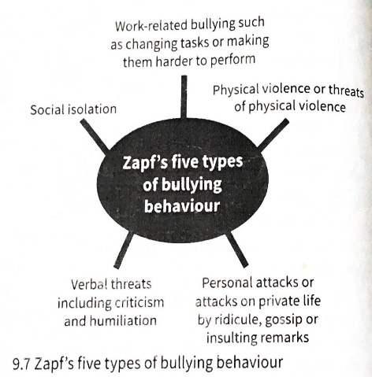

# Organisational work conditions

## Physical and psychological work conditions

### Physical: The Hawthorne Studies (Wickstrom and Bendix, 2000)

* Refers to the idea that individuals modify their behaviour in response to their awareness of being observed.
* Initially conducted in 1924 in USA.
* The managers studied the effects on productivity due to changes in light and work structure (eg. working hours and break times).
* **First study:** effect of light on productivity examined.
  * Experimental group was exposed to decreasing levels of light while the control group was exposed to a constant level of light.
  * **Results:** Both groups increased their performance on their tasks; when the light was as bright as moonlight/dim, the productivity didn't change, which made lighting levels irrelevant.
  * **Conclusion:** light level didn’t significantly affect productivity as long as it was sufficient for the job to be done.
* Workers received special privileges for taking part in the experiments.
* Other experiments were conducted with different variables. Each had drawn the conclusion that the variables didn’t significantly affect the productivity.

### **Conclusions:**

* Improved relationships between workers and the management would improve productivity.
* **Kahn (1975)**
  * Workers in one of the studies increasingly took opportunities to alter their work roles.
  * Kahn described this as the transfer of power, as instead of being supervised, they were consulted about each stage of the experiment.
* **Greenwood (1983)** interviewed the participants of the original study 50 years later and concluded that they had worked harder in the test rooms to avoid being sent back to ordinary manufacturing rooms as the supervision was too ‘harsh’.
* **Notes:**
  * These studies were conducted during economic depression hence the threat of losing one’s job would explain increased work levels.
  * Original experiment also lacked thoroughness with many uncontrolled variables and changes of participants.
  * Workers were being paid according to an incentive pay system based on outcome of the experimental group rather than the workforce as a whole and this is likely to have improved productivity.
* Wickstrom and Bendix advised against referring to the Hawthorne effect in regards to intervention studies as it will add more confusion than clarity.

### Bullying at work (Einarsen, 1999)

* According to Einarsen, bullying is ‘hostile and aggressive behaviour, either physical or non-physical, directed at one or more colleagues or subordinates.’
  * He emphasizes on the need to understand the different types of bullying.

**Zapf (cited in Einarsen, 1999) suggested there are five types of bullying behaviour:**

* One of the key factors in workplace bullying is power.
* According to Einarsen, managers and supervisors are thought as bullies in most cases and bullying by superiority is more psychologically distressing compared to a co-worker.
* Note: important to consider whether peer-bullying and leadership are the same or different enough to warrant separate examination.
* **Four stages of bullying include:**
  * Aggressive behaviour
  * Bullying
  * Stigmatisation
  * Severe trauma
* **Causes of bullying include:**
  * Individual or personality factors of the victim and bully
  * Psycho-social or situational factors

**Bjorkqvist et al., 1994** surveyed employees in a Finnish university and identified **three main reasons of bullying:**

* Competition concerning status and job position
* Envy
* Aggressor being uncertain about their own abilities
  * High proportion of the sample said that the personality of the victim was a significant factor.
* Evidence proves that bullied workers are different than their non-bullied colleagues.
  * Victims are more sensitive, suspicious and angry, tend to have lower self-esteem and more anxious in social settings.
  * However, conclusions should be carefully drawn as no longitudinal study has been conducted to investigate this.
* **Situational factors of bullying:**
  * Deficiencies in work design
  * Deficiencies in leadership behaviour
  * Socially exposed position of the victim
  * Low morale in the department

According to Einarsen, there are 2 **types of Bullying:**

* **Predatory bullying/institutional harassment**
  * When the victim has done nothing to trigger the bullying, but is ‘accidentally’ in a situation where a predator is showing power over others.
* **Scapegoating**
  * When people are stressed or frustrated and want to release the tension. This is an explanation of prejudice.

Quite often, bullying is either not responded to properly or there aren’t proper policies and procedures in action.

### Open plan offices (Oldam and Brass, 1979)

* A field study was conducted which showed that employee satisfaction ratings fell after the working environment was changed to an open plan.

* Research was conducted in a large newspaper office in the USA.

* At the start, all employees worked in a conventional **‘multi-cellular’** office.

  * Each department was in a separate office and each workstation was partitioned.
  * Employees had their own space and they had to travel down corridors and around partitions to communicate.

  

**Reasons management wanted to shift offices:**

* Current office was not near a railway, hence, papers had to be moved by trucks to a railway station costing more and taking up more time.
* There were a lot of practical problems like lack of air conditioning, difficult to heat and limited storage space.
* Current layout limited good communication between individuals and departments. Open plan would alleviate this problem and create a positive working environment.

**The new open plan office**:

* Near a railway line as a typical open plan design.
* There were no internal walls and no cabinets or partitions.
* There were no private offices anywhere except for 2 meeting rooms.
* All members of a department were still grouped together.
* Staff working in the pressroom stayed in the same work space, forming a **naturally occurring control group.**

Informed consent was present throughout all stages of this process and everyone was in agreement to the change.

**Note:** the office was the only changes made, there were no changes made to the working conditions, contracts, salaries or duties.

### **EXPERIMENT**

**Hypothesis**

* It was predicted that there would be an increase in supervisor and co-worker feedback, friendship opportunities, intra-departmental and inter-departmental interactions in an open pan office.

**Sample**

* All 140 full time employees were invited to participate, out of which 128 participated in some way and 76 participated in all stages.
* 5 workers from the pressroom were the control group who participated in all stages.

**Data Collection**

* Data was collected using questionnaires which was given out to groups each ranging from 2 to 12 people.
* **T1:** first set of data was collected about 8 weeks before moving to the new office
* **T2:** data collected 9 weeks after the move
* **T3:** data collected 18 weeks after move
* **The questionnaire contained:**
  * Work satisfaction
  * Interpersonal satisfaction
  * Internal work motivation

**Procedure**

* Participants were told that this was a study to assess employee’s reaction to their new office and their work.
* Participants had to write their names so the responses could be followed through the stages of the study and it was kept confidential.
* Management and staff were also questioned informally for feedback.

**Results**

* A decrease in internal motivation and satisfaction with work and colleagues in new office plan.
* Control group showed no such changes.
* Workers felt difficult to concentrate and complete a task, to develop friendships and to maintain privacy.
* Supervisor also commented that they would have to move to private meeting room to give feedback to a worker.

**Conclusion**

* The findings indicated that open plan offices was the cause of decreased satisfaction and motivation.

### **Evaluation**

**Issues and debates**

* **Individual-situational debate:** clearly, the effect of different working conditions/situation such as office layout or bullying causes changes in the individual.
* **Application:-** important to organisational psychologists for more effective work environment.

**Research methods**

* Hawthorne studies and study of open plan offices were both **experimental studies.**
* Hawthorne was a **field experiment** meaning there is high **ecological validity** although there will be low levels of **control.**
* The study of open plan offices was a **natural experiment** also having high levels of **ecological validity** but hardly any **controls.**
  * **Control group** had only 5 individuals making comparisons difficult.
  * Data was only collected on worker motivation and satisfaction however scores on productivity and efficiency may have been significant to the study.
  * In addition, a longer study may have had more positive results.