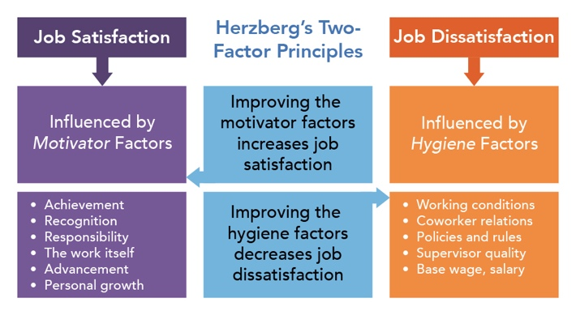
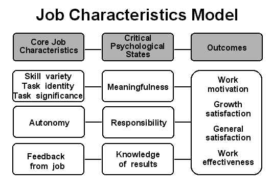

# Satisfaction at work

## Theories of Job satisfaction

### Two-factor theory (Herzberg, 1959)

* Two-factor theory states that job satisfaction and dissatisfaction work independently of each other – each entity is separate, consisting of separate job characteristics.
* Herzberg states that workers are not satisfied with jobs that simply meet lower-level needs.
* Gratification of higher-level needs are sought, which are met by the nature of their work rather than just the salary.

**Sample**

* 200 engineers and accountants in Pittsburg area were chosen for interviews.

**Procedure**

* Participants were asked to give a detailed description of periods in which they were ‘exceedingly happy’ and ‘exceedingly unhappy’ with their jobs.

**Results**

* Factors of the job that caused gratifying characteristics such as a sense of achievement lead to satisfaction

* However, if these gratifying characteristics were absent, it did **not** lead to dissatisfaction.

* Dissatisfaction is caused by different factors such as working conditions, technical problems and salaries.

* **Hygiene factors:** factors that don’t contribute to satisfaction but their absence causes dissatisfaction eg:

  * Job security
  * Salary
  * Working conditions
  * Benefits: paid holidays, insurance

**Motivating factors:** factors that produce satisfaction but their absence does not lead to dissatisfaction eg:

* Challenging and rewarding work
* Responsibility and autonomy
* Recognition and sense of accomplishment

* **Two factor theory produces 4 possible combinations:**

|**Hygiene factors**|**Motivating factors**|**Description**|
|:---|:---|:---|
|**High**|High|Highly motivated with few complaints|
|**High**|Low|Few complaints but not highly motivated. Job is viewed as a pay-packet|
|**Low**|High|Motivated with lots of complaints. Job is exciting and challenging but salaries and working conditions are poor|
|**Low**|Low|Not motivated and have many complaints|

### Job characteristic theory (Hackman and Oldham, 1976)

* A theory that includes the following set of characteristics which lead to appealing and motivating jobs:
  * **Skill variety:** jobs should require a variety of skill set and utilise the pre-existing skills of the worker
  * **Task identity:** jobs should require completion of entire work and involve workers holistically rather than in a disjointed element.
  * **Task significance:** jobs should have significance and impact on other people
  * **Autonomy:** jobs should allow workers to have some autonomy and flexibility in planning, scheduling and doing their work etc.
  * **Feedback:** the job itself should give information on how well the worker is performing

### Techniques of job design

* **Job enrichment:** involves giving workers a greater variety of tasks to perform increasing skill set and responsibility. This gives workers a greater sense of control over their job and makes their job interesting.
* **Job rotation:** having regular changes in tasks within normal role eg workers in a kitchen can rotate around all the different preparation areas.
* **Horizontal job enlargement:** giving workers more tasks to do but usually at the same level of skills and responsibility.
* **Vertical job enlargement:** addition of further decision making responsibilities and/higher level, challenging tasks without formal promotion. This increases competence and sense of empowerment. Allowing teams to manage themselves is an example.

### **Evaluation**

* **Two factory theory (Herzberg)**:
  * **Application to real life:** Herzberg clearly differentiated between factors that create satisfaction and those that create dissatisfaction. Organisations can use this information to improve satisfaction at work.
  * **Generalisability** was high due to a large sample of 200 people.
* **Job characteristics theory (Hackman and Oldham’s):**
  * **Application to real life:** by identifying critical job characteristics that affect motivation, satisfaction and work performance, organisations can design jobs around these characteristics.
  * Several studies demonstrate that core characteristics do correlate with motivation and satisfaction.
  * **Individual and situational debate:** relatively small changes to job characteristics (situation) can impact individuals and attitudes.