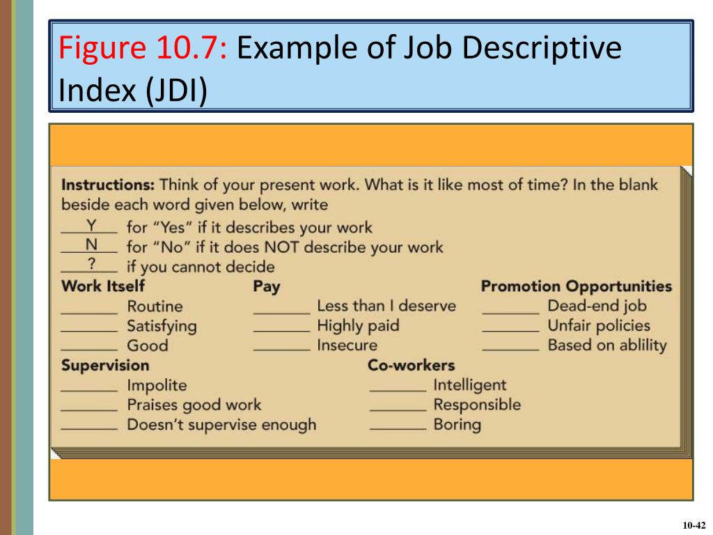

## Measuring job satisfaction

### Job Descriptive Index (Smith et al., 1969)

* **Measures 5 aspects of job satisfaction:**
  * Experience of the work
  * Salary
  * Promotion prospects
  * Experience of supervision
  * Experience of co-workers
* **Advantages:**
  * Answered using simple language: yes, no or can’t decide
  * Results are compared with standardised norms based on regularly updated data from large samples
  * Scores between similar individuals can be compared with normative/baseline scores to establish whether a person is more/less satisfied.
  * It measures specific, objective areas of job satisfaction rather than in general terms
  * Easy to read and doesn’t use complex language, making it easy to use within large variety of people

### Minnesota Satisfaction Questionnaire (Weiss et al., 1967)

* **Measures a range of aspects around the job including:**
  * Company policies
  * Scope for advancement
  * Security
  * Independence
  * Recognition
  * Responsibility
  * Variety and working conditions
* **It originally used the following 5 response choices:**
  * Very satisfied
  * Satisfied
  * N (neither satisfied nor dissatisfied)
  * Dissatisfied
  * Very dissatisfied
  * However, results obtained tended to be ‘skewed’ and generally alternated between ‘satisfied’ and ‘very satisfied’
* Thus, **a later version** was created with the following responses:
  * Not satisfied
  * Somewhat satisfied
  * Satisfied
  * Very satisfied
  * Extremely satisfied
  * Results from this version tended to be more varied and had more symmetrical distribution around ‘satisfied’, the central point.

### Quality of working life (QWL) questionnaire (Walton, 1974)

* Quality of working life involves a range of factors such as job security, reward system, pay, opportunities for growth, etc
* Walton developed a typology which can be used to assess the QWL and it consists of eight key components:
  * **Fair and adequate payment,** which can be measured by:
    * Asking questions to find whether pay received is enough and whether it is equivalent to that received by other workers
    * Rating their agreement to statements such as ‘I am satisfied with the amount I earn’
  * **Safe and healthy working conditions:** multiple factors such as appropriate clothing and safety procedures must be in place to increase QWL.
  * **Providing opportunities to use and develop skills:** autonomy, independence and skill development will increase QWL.
  * **Opportunity for career growth and security:** job security and growth will increase QWL. Fixed term or zero hour contracts (no guaranteed working hours) will drop QWL.
  * **Positive social relationships:** this will increase productivity, satisfaction and decrease stress, absenteeism and turn over – increasing QWL.
  * **The total life space:** the extent to which employees could maintain their work-life balance.
  * **Constitutionalism (policies and procedures):** such as those to limit bullying, harassment, etc and the extent to which employees agree with the organisational procedures, cultures etc.
  * **Social relevance:** the extent to which the work you –or the organisation- does is relevant to society.

### **Evaluation**

* **All three:**
  * Psychometric form of testing that have demand characteristics and social desirability bias
  * Widely used and the results can be applied to improve aspects of working environment, satisfaction, motivation and productivity.
* **Job Description Index:**
  * Most thoroughly tested and carefully validated based on standardised norms
  * This means that scores can be compared to a huge sample of participants from different occupations
  * Thus, scores can be used to identify whether the individual is more or less satisfied than others of the same occupation, sex, age, etc
* **Minnesota Satisfaction Questionnaire:**
  * Well validated however offering respondents only **slightly different responses** to choose from can have **significant effect**s on the answers
  * This reduces reliability and validity of the test
* **QWL** is useful and has helped initiate policies regarding bullying, compassionate leave and working flexibly allowing social activities that promote the quality of work life.