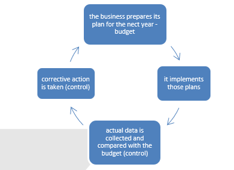

# Elements of costing and management accounting

## **Costing for materials, labour and overheads**

* Cost accounting is a method of accounting where all costs relating to a certain activity are grouped together, classified and recorded

* Management accounting is the process of preparing reports and accounts to be used by internal parties such as managers for decision making on future performance of the business

* Direct costs are costs incurred with directly relate to the production of the good or service example: raw materials, carriage inwards, royalties.

* Indirect costs are costs that aren’t directly linked with the production of goods and services example: cleaning materials, supervisor salary, factory managers.

* Fixed costs are costs that remain unchanged while the level of output or activity increases or decreases, example: rent

* Stepped fixed cost is cost that does not change within certain high or low threshold of the activity but which will change once these thresholds are breached

* Variable costs are costs that varies on the level of output of activity, example: direct costs that vary in proportion to the number of units produced

* Cost unit is the unit of output of a business to which costs can be charged

* IAS 2 allows two different methods for valuing direct material inventory.