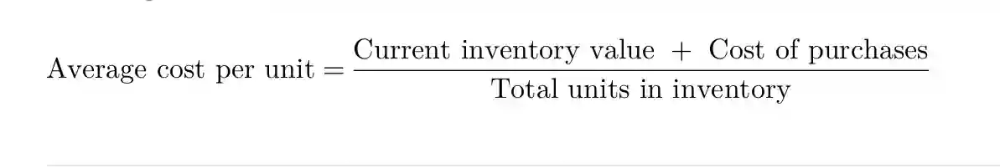

The valuation of inventory may be difficult because goods are purchased over different time periods and different prices will be paid for the same items. There a three methods of valuing inventory:

* FIFO – First in first out
* AVCO – average cost
* LIFO – Last in first out.

## FIFO

This method assumes that the items purchased first were also sold first.

Any unsold items are considered to be those purchased most recently.

### Advantages of FIFO

* Closing inventory is based on the most recent prices paid.

* Inventory valuations are based on actual prices paid for items.

* It is logical because it assumes that sales are made from the oldest
  items of inventory first.

* Using FIFO March: 1000 units of inventory purchased at $4

July: 500 units of inventory purchased at $8

September: 1100 units of inventory sold

|DATE||RECIEVED|||ISSUED|||INVENTORY|VALUATION||
|:---|:---|:---|:---|:---|:---|:---|:---|:---|:---|:---|
||**QTY**|**PRICE**|**VALUE**|**QTY**|**PRICE**|**VALUE**|**QTY**|**PRICE**|**VALUE**|**TOTAL**|
|||**$**|**$**||**$**|**$**||**$**|**$**|**$**|
|March|1000|4|4000||||1000|4|4000|4000|
||||||||||||
|July|500|8|4000||||1000|4|4000||
||||||||500|8|4000|8000|
||||||||||||
|September||||1000|4|4000|400|8|3200|3200|
|||||100|8|800|||||
||||||||||||

## AVCO

* The average cost method of inventory valuation involves recalculating the average cost of inventory after each new purchase.

* Formula:

### Advantage of AVCO

* Identical items in the inventory are given identical cost.
* Using the same numerical example for AVCO would look like this

|**Date**||RECEIVED||ISSUED|Avg. Cost|INVENTORY|VALUATION|
|:---|:---|:---|:---|:---|:---|:---|:---|
||**QTY**|**PRICE**|**VALUE**|**QTY**||**QTY**|VALUE|
|||**$**|**$**||||$|
|March|1000|4|4000||4|1000|4000|
|||||||||
|July|500|8|||5.33|1500|8000|
|||||||||
|September||||1100|5.33|400|2132|
|||||||||
|||||||||
|||||||||

* *Note*: Avg. cost of inventory only changes when goods are purchased not sold. The goods are sold at the average price. When new inventory is purchased it changes the average cost of the held inventory, therefore causing the change.

## LIFO

* The last in first out method assumes that the items purchased most recently were sold first.

The result of this is that any unsold items are considered to be those purchased earliest.

### The effect of inventory valuation on the financial statements:

* The cost of sales when using FIFO method will be lower than when using AVCO.

* The profits using FIFO will be higher than when using AVCO

* In long term, profits using both methods will be exactly the same, as eventually all inventory will be sold, but in the short term, FIFO will produce higher profits than AVCO.

* FIFO also produces higher current assets and net assets on the statement of financial position than AVCO.