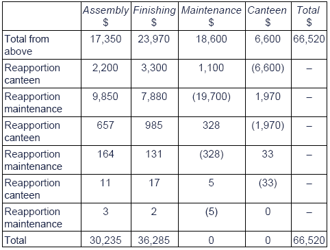

## Absorption Costing

***Apportionment of overheads to cost centres.***

* Cost centres are any location in a department to which costs may be attributed.
* Production cost centres are locations which are directly involved in producing goods
* Service cost centre are locations which are not involved in the production of goods but provide services for the production cost centres eg, stores.
* Allocation of costs is charging costs directly to the cost centres which can be directly identified with them, for instance wood, metal, plastic, components and chemicals are allocated to the production department. Packing materials are allocated to the packing department.
* Apportionment of cost is the process of charging costs to cost centres using a suitable basis, these costs cannot be directly identified with a single cost centre.

|Overhead|Basis of apportionment|
|:---|:---|
|Rent and rates, heating and lighting, building depreciation, insurance, building expenses, rent|Floor area|
|Actual consumption|Power|
|Depreciation, insurance of plant and other machinery|Cost or replacement value of asset|
|Storekeeping costs, material handling costs|Store requisition|
|Welfare costs, canteen costs, administration costs, supervision|No. of employees|
|Machines repairs|Machine hours|

* Steps to absorption costing
  * if a manufacturer has four production cost centres; moulding, machining, painting and packaging, Given basis for each department for rent is floor area of $1000m^2,700m^2,500m^2 and 300m^2$ respectively. If rent was 45000 dollars, the cost will be apportioned as  below

|Expense|Moulding|machining|Painting|Packaging||
|:---|:---|:---|:---|:---|:---|
||Rent|18000|12600|9000|5400|
|||||||

* This is known as primary apportionment Overhead analysis sheet

* After apportionment, If the service cost centres provided services to the production cost centres they will need to be reapportioned to the production centres on suitable bases, the simplest and quickest method is the elimination method (this is where the service costs are apportioned using bases which don’t involve the service sot centre in question).

* Another method is the reciprocal method as shown below where the cost centres are apportioned until they reach immaterial values

* Calculating the Overhead Absorption Rate [OAR] : rate at which costs are apportioned to a cost centre are charged to the cost unit passing through it, OARs are used to calculate overhead attributed per unit, it is calculated by:

  * budgeted production overheads/budgeted activity level (labour hours or machine hours)

* Usually both direct labour and machine hours are given, always choose the greatest and **never** add the two sets together

* Once the OAR rate is found this will be multiplied by the number of hours used to make the product to obtain the amount of overhead absorbed.

* Under/over absorption is calculated by:

|Actual overheads|XXX|
|:---|:---|
|(less) absorbed overhead (OAR * actual hours)|(xxx)|
|Under absorbed|xxx|

* If absorbed overheads was however greater than actual overheads then this will result in over absorbed
* Reasons for under absorption
  * Actual expenditure is greater than budgeted
  * Production is less than the planned level, not enough overheads has been charged to production.
* Reasons for over absorption
  * Actual expenditure is less than budgeted expenditure
  * Actual production is more than the planned level, too much overhead was charged to production.
* Benefits of absorption costing
  * Acceptable under IAS as well as GAAP
  * Accounting for all production cost not just direct cost hence giving a complete picture of the cost per unit, more realistic selling price as a result
  * Gives a better view on profitability then variable cost especially if not all products are used during the same period.
  * Better suited for companies which have constant demand for products
* Drawbacks of absorption costing
  * As this is based on both fixed and variable costs, this method cannot be used for management decision making or planning further actions like budgeting
  * Absorption makes It difficult to do cost volume profit analysis, as with additional fixed cost, the variations in the variable cost becomes difficult to determine. Making it difficult to assess efficiency and effectiveness.
  * Profits are needed to be adjusted for over and under absorption of fixed costs, this can make the calculation of profits difficult and complicated especially when the company has too many products.