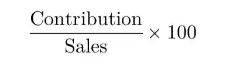
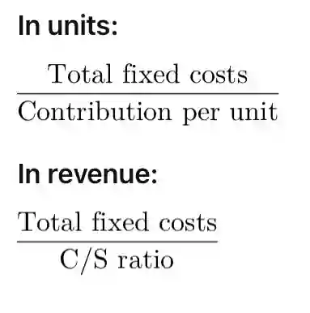
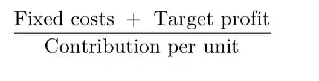
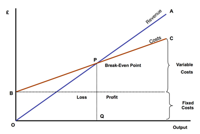
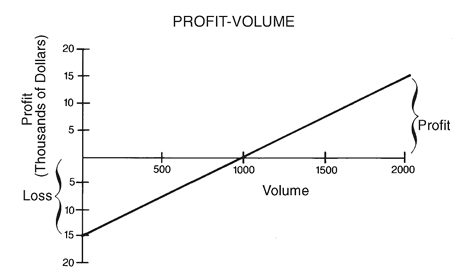

## Marginal costing

* Marginal costing is the cost of making an extra unit of output.

* Contribution is the difference between the selling price and the variable cost of a unit of output.

  * selling price - variable cost per unit

* Contribution to sales ratio (C/S ratio) is the ratio of contribution to the selling price, calculated by;

  

* Break even point is the level of output in which the business makes neither a profit nor a loss, total contribution is exactly equal to total fixed costs.

  

* If there the business has a target profit set the breakeven level of output will be calculated by:

### Breakeven charts

* Are diagrammatic representation of profit or loss to be expected from the sale of a product at various levels of activity.

* Cost volume profit analysis is a way of finding out how changes in variable and fixed cost affect a firms profit. These are used by companies to see how many units they need to sell to breakeven or reach a certain minimum profit margin.

* Margin of safety  is the difference between the breakeven point  and the level of sales , this is found by total units sold - breakeven level of output or the following equation is used to calculate margin of safety rate $\frac{profit}{\frac{c}{s}ratio}$

* Profit volume chart is a type of breakeven chart which only shows the profit of loss at each level of output.

* At 1000 units of output the business incurs neither a profit nor a loss, the units exceeding the BEO is the margin of safety which is 1000 units.

### Limitations of breakeven charts

* it assumes there are no changes in the level of inventory, everything produced is assumed to be sold during that period which is unrealistic.
* It doesn’t allow for a mix of products and is usually calculated for a single product which.
* Cost behaviour is assumed to be either fixed or variable, so semi variable costs are not considered. Similarly stepped costs are also not included
* Variable costs are assumed to be perfectly linear with the level of production so changes in costs such as bulk purchase discounts or overtime rates aren’t considered.
* The selling price is assumed to remain fixed throughout the year so seasonal sales or discounts aren’t considered, this is misleading.

### Advantages of breakeven analysis

* Charts are easy to construct and understand
* Provides useful guideline for managers like breakeven points, safety margins when taking decisions such as on ordering raw materials and budgeting.
* Comparison between different options and draw a new chart to show changing situations such as a price increase.

### Acceptance of orders below normal selling price

* When the order results in a contribution to cover fixed costs, the selling price must exceed marginal cost of production
* To maintain production and avoid laying off skilled workforce during off season
* To promote a new product.
* To dispose of slow moving or redundant inventory
* The business should consider if they have the available spare capacity.

### Make or buy decisions

* if the marginal cost of production is below the price quoted by the supplier then the offer should be rejected.
* The business should consider
  * Will the price offered by the suppliers change?
  * The quality of the supplies offered by the external supplier.
  * Will there be delays in delivery?
  * Is there an alternative use for the resources?
  * Will the business lose the services of skilled workers which may be difficult to replace at a later date?

### Dropping a product

* if a business is dealing with a range of products and one of which is deemed to be unprofitable, it may consider dropping the item from its range.
* When the contribution is negative, but if the product has a positive contribution and a negative profit, it is favourable to continue the production as it would still be covering some of the fixed cost.

### Choice of product where a limiting factor exist

* a limiting factor is anything that limits the quantity of goods that a business may produce. This may include the shortage of materials, labour and demand for a particular product.
* When making the best use of limited resources the product must be ranked according to the amount of contribution they make from each unit of the scarce resource.
  * Step 1: calculate the contribution per unit
  * Step2: identify the limiting factor and limiting factor per unit
  * Step 3: find $\frac{contribution}{limiting\ factor\ per\ unit}$
  * Step 4: based on the answer, state the rank in descending order
  * Step 5: calculate the optimum production capacity, produce a revised production plan considering the shortage

### Marginal costing VS absorption costing

* Marginal costing: using this method, fixed costs are treated as period costs and written off each period. Finished goods and work in progress are valued at marginal cost only i.e. variable costs.
* In inventory valuation, when using marginal costing the closing inventory will only include the variable cost. While, in absorption the variable as well as some of the fixed overhead will be included hence giving a greater gross profit for absorption as closing inventory is valued more than marginal. This difference arises purely due to the way the fixed overheads are treated.

### Format of an operating statement (marginal costing)

||$|$|
|:---|:---|:---|
|Sales||x|
|(-) variable cost:|||
|Materials|x||
|Labour|x||
|Overheads|x||
|(\+) opening inventory|x||
|(-) closing inventory \\n $\frac{total\ variable\ production\ cost}{total\ units\ produced} \times closing\ inventory$|(x)|(x)|
|||x|
|(-) selling variable expenses||(x)|
|Contribution||x|
|(-) fixed costs|||
|Admin costs|x||
|Production costs|x|(x)|
|Profit for the year||X|

* Absorption costing uses all costs which are absorbed into production and thus operation statements do not distinguish between fixed and variable cost. Valuation of both finished and work in progress inventory contain both fixed and variable costs.

Format of an operating statement (absorption)

||$|$|
|:---|:---|:---|
|Sales||x|
|(-) production costs|||
|materials|x||
|labour|x||
|fixed overheads|x||
|(\+) opening inventory|x||
|(-) closing inventory $\frac{total\ variable\ production\ cost}{total\ units\ produced} \times closing\ stock\ units$|(x)|x|
|gross profit||x|
|(-) fixed and variable operating expenses|||
|admin expenses||(x)|
|selling and distribution expenses||(x)|
|profit for the year||x|

### Uses of marginal costing

* Clear distinction between variable and fixed costs which is helpful in short term decision making.
* Sees costs allocated to a time period so that it may be argued that profits for the time period is more accurate.
* It is prudent to write off costs in the time period incurred and therefore marginal costing methods include accurate inventory valuation of and as well as profits.
* Easy to operate but relied upon cost being split into fixed and variable. No arbitrary apportionment of fixed costs.
* Shows clearly the impact on profit of fluctuations in the volume of sales.
* Under and over absorption is not a problem hence no need to calculate and OAR
* Can also be used with standard costing.
* Shows relative contributions to profit that are made by each product and shows where the sales effort should be contracted.

### Disadvantages of marginal costing

* Not all costs can be split into variable and fixed
* Fixed costs don’t in reality remain constant and variable costs do not vary according to levels of output, in the long run all costs are variable
* Assumes production method remains constant which isn’t the case in reality.
* Contribution may vary if new techniques are followed in the production process.
* It isn’t useful for business with a range of products as allocating fixed costs to each product will be difficult with any degree of accuracy, making difficult to calculate the breakeven point.

### Uses of absorption costing

* Includes all costs to product there it could be useful for management when fixing prices or reviewing of a product has been profitable.
* It could be said that profit gives a true and fair view according to absorption costing
* Helps set prices.
* Used in the long run rather than short run.
* More acceptable and realistic for financial statements.

### High low method

* This technique uses the units and total cost at one level of activity compared to the units and total costs incurred at another level to calculate the variable cost per unit.
* This is used to split and find the fixed element and the variable element of a semi variable costs.
* Once variable cost is found, fixed costs can be found by deducting the variable cost from the total cost.
  * $\frac{highest\ cost - lowest\ cost}{highest\ activity - lowest\ activity} = variable\ cost\ per\ unit$