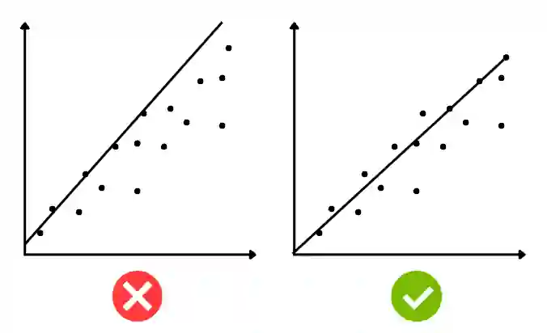

## Best fit line

* A proper best fit line touches as many points as possible and highlights the general trend of points. 

* It can be used to estimate the value of any point. 

* The line does not always have to start at the origin and the line must be places in a way where there are equal points above and below the line. 

* The best fit line doesnt always have to touch the top and bottom point. 

