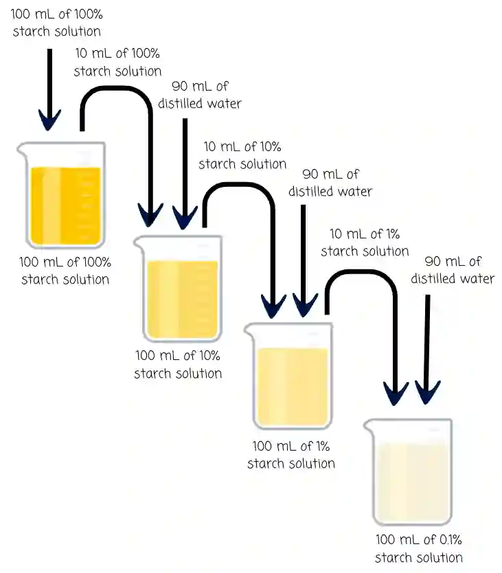

## Types of Dilutions

* **Serial dilutions**: Serial dilution is a type of dilution technique where you create your solutions by diluting the previous dilution.

  * Eg: 1 cm³ --\> 0.1 cm³ --\> 0.01 cm³

* Simple dilutions: A dilution technique where all the solutions are made from the original stock solution.

  * Eg: making 100 cm³ of a 10% solution from a 100% stock solution.

## Serial dilution

* In serial dilution you use your main stock solution to create new solutions that are used to make the next, lower concentrated solution.

* To perform serial dilution you can follow the steps

  * Eg: Make 100 mL of 0.1% starch solution from 100 mL of 100% starch solution.

  1. Take 10 mL of 100% starch solution and add it to a beaker.

  2. Add 90 mL of distilled water and mix. This produces 100 mL of 10% starch solution.

  3. Take 10 mL of the 10% starch solution and add it to a new beaker.

  4. Add 90 mL of distilled water and mix. This produces 100 mL of 1% starch solution.

  5. Take 10 mL of the 1% starch solution and add it to a new beaker.

  6. Add 90 mL of distilled water and mix. This produces 100 mL of 0.1% starch solution.

  ### So the serial dilution is:

  **100% → 10% → 1% → 0.1%**

* If you are asked to make a diagram of your dilution process, it must look like this. 

## Simple Dilutions

* Simple dilutions use a volume of the given stock solution (a concentrated solution used to prepare solutions of lower concentrations) and a mixture of distilled water to make the desired concentrated solution. 

* The final volume is the total volume after mixing.

* The amount of starch stays the same, but adding water makes it less concentrated.

* To find out how much of each liquid to add, you can use the formula C₁V₁ = C₂V₂

  * Eg: you want to make a 10 mL of 50% starch solution. You are given 100% starch solution and distilled water

  * Substitute the values into the formula. 

    * C₁= 100% starch solution (100/100) (1) 

    * **V₁**= The unknown value you would need to find 

    * C₂= 50% starch solution desired (50/100) (0.5)

    * V₂= 10 mL of solution required

  * Rearrange equation to find value of V₁

    * (C₂V₂) / C₁ = (0.5 x 10) / 1 

      =\> 5 mL

  * Now you would need a volume of 10 mL so 10-5 = 5 mL of water needs to be added to prepare your final solution. 

* In exam questions, you would be required to fill out a table as such: 

#|
||

**Desired starch concentration**

|

**100% starch solution / mL**

|

**Distilled water / mL**

|

**Final volume / mL**

||
||

0%

|

0 . 0

|

10 . 0

|

10 . 0

||
||

25%

|

2 . 5

|

7 . 5

|

10 . 0

||
||

50%

|

5 . 0

|

5 . 0

|

10 . 0

||
||

75%

|

7 . 5

|

2 . 5

|

10 . 0

||
||

100%

|

10 . 0

|

0 . 0

|

10 . 0

||
|#

