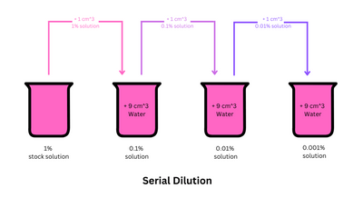
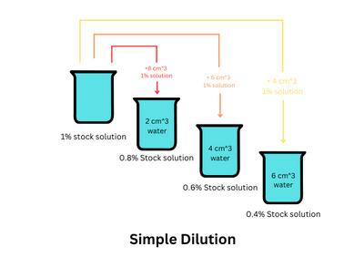

## Methods of Dilution

### Serial Dilution
- read the question carefully and determine whether they want you to dilute by half or by a factor 

  - reduce solution by half each time, and add equal parts of the solution and distilled water that adds up to a total volume as the previous solution (e.g. if you want to make $10cm^{3}$ of each concentration then have  $20cm^{3}$ of stock solution for 1st beaker, take $10cm^{3}$ from this beaker and $10cm^{3}$ of distilled water, add this to another beaker, do the same till further 4 concentrations are made (including 0)

  - dilute the solution by a factor of 10 (factor is mentioned in the question) each time,  add 1cm3 from the previous solution and $9cm^{3}$ of distilled water to make a total solution of $10cm^{3}$ each time
  
  

### Simple Dilution

1. first figure out the total concentration of the stock solution
2. make 4 more concentrations and include 0 as a concentration as well
3. to find the volume of stock solution required use the formula **$C_1V_1 = C_2V_2$**
this will help you to find the volume of stock solution required
4. when making the dilution the solution has to be taken from the main solution each time
5. to find the volume of distilled water required use formula:
  - Volume of distilled water = Final volume - Volume of stock solution used 
  
  
