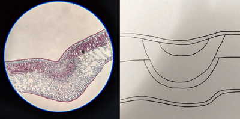
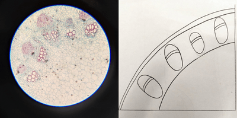
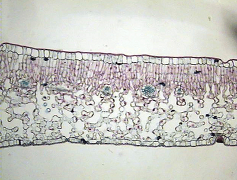
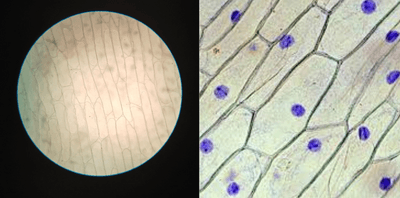
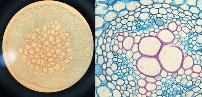
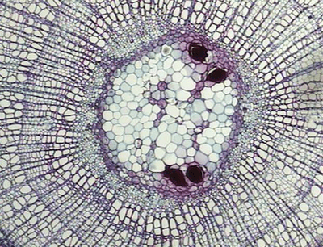
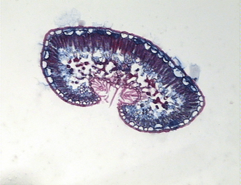

# Photomicrographs and Plan diagrams

## Plant slides

### T.S of Leaf midrib

### T.S of Stem

### T.S of lamina

### Plant cell

### T.S of Dicot Root

### Pith of Stem

### T.S of Xerophytic leaf

