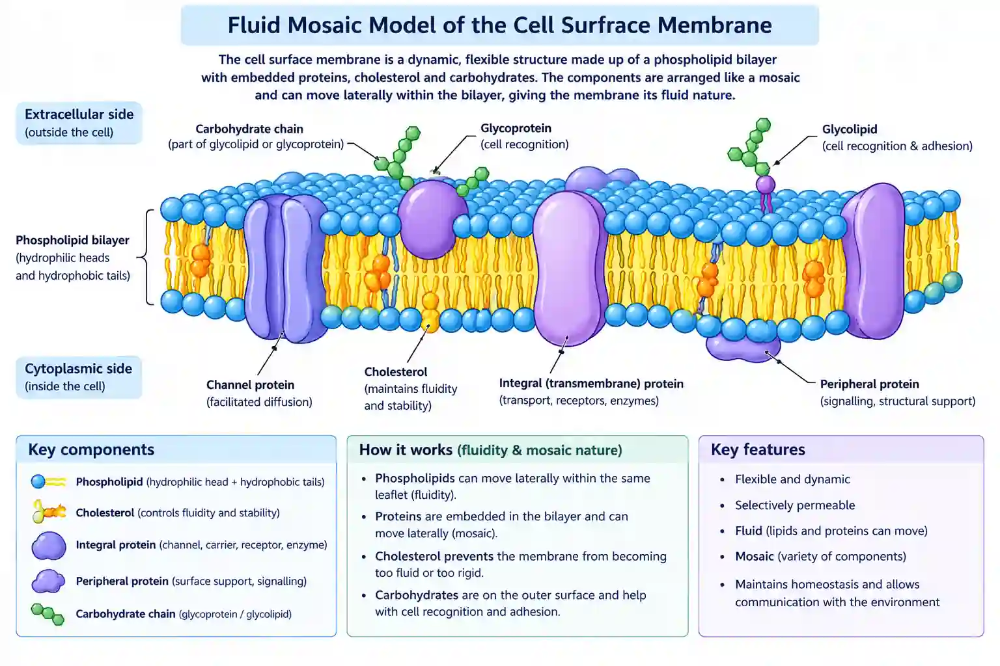
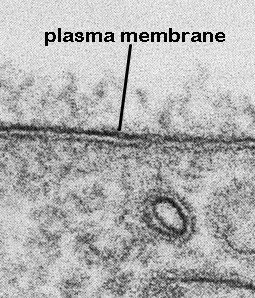
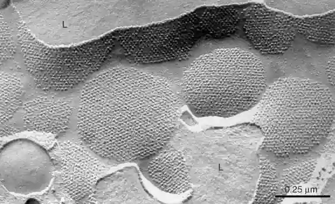
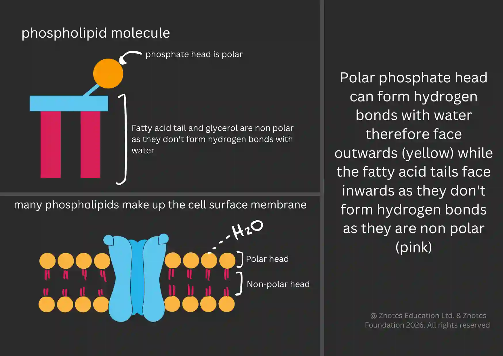

# Cell Surface Membrane

## Fluid Mosaic membranes

Fluid: phospholipids and proteins can move laterally (sideways) within their own monolayer.

Mosaic: Pattern produced by the scattered protein

Evidence:

#|
||

Cell under electron microscope with heavy staining

|

Freeze-Fracture

||
||

Trilaminar appearance (dark light dark)

|

The Process: A cell is frozen rapidly and then "cracked" with a microscopic blade. The crack usually happens right down the middle of the bilayer (between the two monolayers of tails).

When they looked at the exposed interior faces, they saw bumps and pits.

Those bumps were integral proteins that go all the way through the membrane.

||
||

|

||
|#

### How the bilayer is formed:

* Phospholipid heads are polar, so they are directed outward to interact with water molecules in the surroundings.

* Their tails are non-polar, so directed inwards to not interact with water.

**The bilayer acts as a barrier to polar substances e.g. ions thats why its partially permeable.**

### Permeability:

* The bilayer prevents most molecules from crossing. Embedded proteins act as channels to allow other substances in and out.

* Small, nonpolar, or hydrophobic molecules can pass through the membrane easily, whereas large, charged, or polar molecules (like ions, sugars, and amino acids) are restricted, requiring specific transport proteins.

* Water can pass the bilayer as it’s small, even though it’s polar. By osmosis, however, this is slower than if it passes through a transport protein (aquaporin).