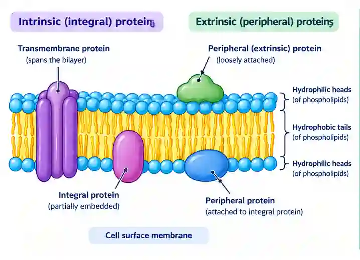

## Extrinsic and intrinsic proteins

* Intrinsic/integral proteins are embedded in the cell surface membrane

  * The polypeptide that’s next to the phosphate head is polar and has hydrophilic R-groups and form hydrogen bonds with the surrounding water molecules.

  * The polypeptide next to the fatty acids is non-polar and has hydrophobic R-groups forming hydrophobic interactions with the fatty acid tails.

    * e.g. Channel and Carrier Proteins

    * Both use facilitated diffusion

    * Both are transport proteins

    * Carrier proteins have a specific binding site

    * Carrier proteins also use active transport

* Extrinsic/peripheral found on the inner or outer part of the membrane
* Extrinsic proteins are often held by **ionic bonds** or hydrogen bonds to the phosphate heads or to intrinsic proteins.

* Carbohydrates with lipids form a glycolipid, while carbohydrates with proteins form a glycoprotein

* Their function:

  * Act as receptors for cell signalling.

  * Act as enzymes

  * Act as antigens for cell recognition, acting as antigens for immune system recognition.

  * Form hydrogen bonds with surrounding water molecules

  * Allow cell-to-cell adhesion