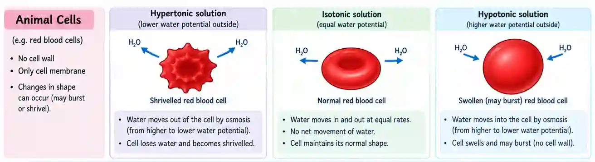
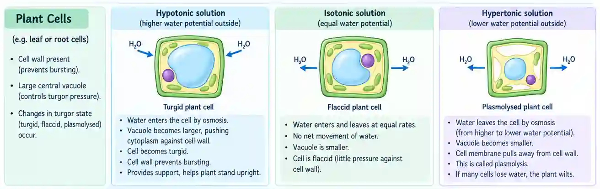

## Movement of Cells Into and Out of The Cell

### Diffusion

* Net movement of particles from a region of high concentration gradient to low concentration gradient.

* Using energy from random movement of particles.

* Diffusion is a passive process that does not require energy from ATP

* Diffusion is of 2 types

  * ### Simple Diffusion

    * Does not need a transport protein such as a channel or carrier protein

  * ### Facilitated Diffusion

    * Diffusion of ions and polar molecules

    * Uses carrier or channel proteins

    * Each type of protein channels allow only one kind of polar molecules or ions to diffuse through it.

### Osmosis

* Movement of particles from a region of high water potential to a region of low water potential.

* Represented by the letter psi (ᴪ)

* The highest water potential is that of distilled water

* By increasing solute in water, water potential decreases and becomes more negative while decreasing solute in water allows for water potential to increase.

* ### **Animal cells**

  **In a hypertonic solution**

  * The solution outside the cell has a **lower water potential** than the cell.

  * Water moves **out of the cell by osmosis**.

  * The red blood cell **loses water and becomes shrivelled**.

  **In a hypotonic solution**

  * The solution outside the cell has a **higher water potential** than the cell.

  * Water moves **into the cell by osmosis**.

  * The red blood cell **swells and may burst** because it has no cell wall.

  **In an isotonic solution**

  * The water potential inside and outside the cell is **equal**.

  * Water moves into and out of the cell at **equal rates**.

  * There is **no net movement of water**, so the cell maintains its normal shape.

    

* ### **Plant cells**

  **In a hypotonic solution**

  * The solution outside the cell has a **higher water potential** than the cell.

  * Water enters the cell by osmosis.

  * The vacuole becomes larger and pushes the cytoplasm against the cell wall.

  * The cell becomes **turgid**.

  * The **cell wall prevents the cell from bursting**.

  * Turgid cells provide **support to the plant**, helping it remain upright.

  **In an isotonic solution**

  * The water potential inside and outside the cell is **equal**.

  * Water enters and leaves the cell at **equal rates**.

  * There is **no net movement of water**.

  * The cell is **flaccid** because there is little pressure from the cell contents against the cell wall.

  **In a hypertonic solution**

  * The solution outside the cell has a **lower water potential** than the cell.

  * Water leaves the cell by osmosis.

  * The vacuole becomes smaller and the cell contents shrink.

  * The cell membrane pulls away from the cell wall.

  * This is called **plasmolysis**, and the cell is described as **plasmolysed**.

  * If a plant loses water through osmosis, many cells can become plasmolysed, causing the plant to **wilt**.

    

### Active Transport

* Transport of molecules or ions form a region of low concentration to high concentration/against concentration gradient.

* Transport proteins, are sometimes known as carrier proteins.

* Active transport pumps hydrolyze ATP into ADP \+ P(inorganic phosphate) , which in turn gives energy

* Carriers use energy to move or to change their 3D shape to carry molecules or ions against their concentration gradient.

What affects Active transport:

* Cell surface area: more area means more carrier proteins can be used.

* Oxygen concentration increases the rate of active transport, as it's used in the production of energy by aerobic respiration in mitochondria

