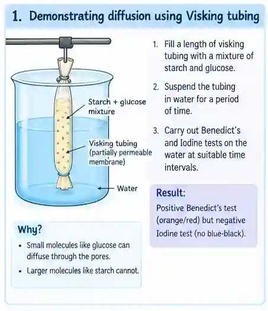
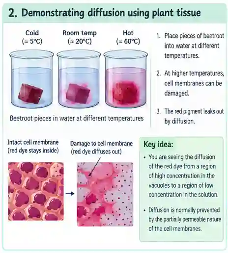
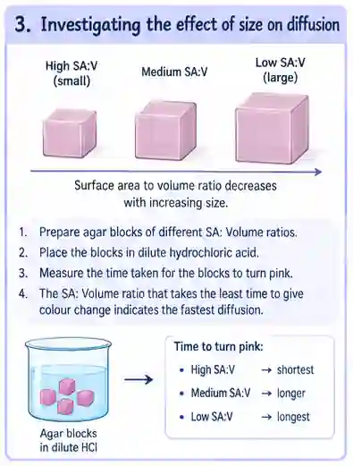
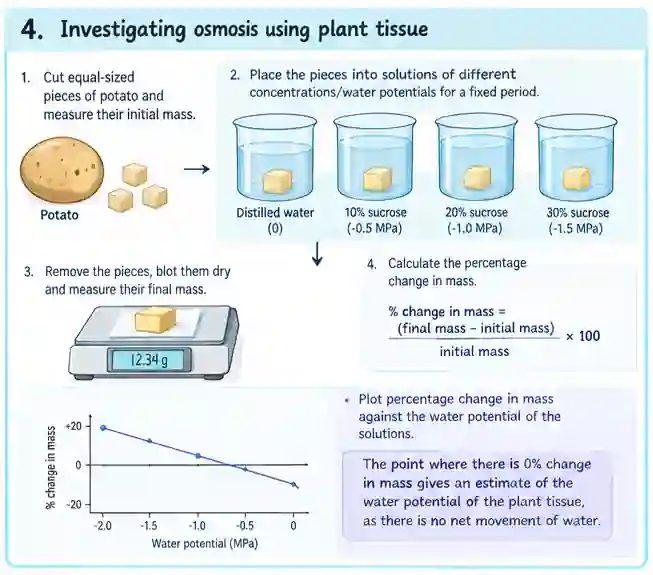
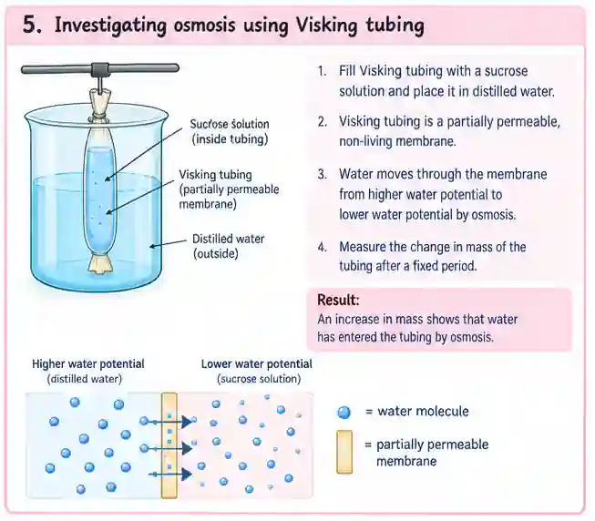

## **Investigations**

### **Demonstrating diffusion using Visking tubing**

* Visking tubing is a partially permeable, non-living membrane made from cellulose.

* It has pores which can allow small molecules like glucose to diffuse through but won’t allow larger molecules like starch to diffuse through

* Fill a length of visking tubing with a mixture of starch and glucose

* Suspend the tubing in water for a period of time

* Carry out Benedict’s and Iodine tests on the water at suitable time intervals to check for the presence of glucose and starch.

* A positive result for Benedict’s test but a negative result for the iodine test will be obtained.

  

### **Demonstrating diffusion using plant tissue**

* Pieces of beetroot can be placed into water at different temperatures

* Any damage to the cell membranes results in the red pigment leaking out of cells by diffusion

* What you are seeing is the diffusion of the red dye from a region of high concentration in the beetroot vacuoles to a region of low concentration in the solution outside the beetroot

* Only at temperatures at which the cell membrane starts to damage does the red dye start to diffuse out (diffusion is normally prevented by the partially permeable nature of the cell membranes)

  

### **Investigating the effect of size on diffusion**

* Surface area to volume ratios decrease with increasing size of 3D structures.

* Prepare agar blocks of different SA: Volume ratios

* Place the blocks in dilute hydrochloric acid

* Measure the time taken for the blocks to turn pink

* The SA: Volume ratio that takes the least time to give colour change indicates the fastest diffusion

### **Investigating osmosis using plant tissue**

* Cut equal-sized pieces of potato and measure their initial mass.

* Place the pieces into solutions of different concentrations/water potentials for a fixed period of time.

* Remove the pieces, blot them dry and measure their final mass.

* Calculate the percentage change in mass.

* Plot percentage change in mass against the water potential of the solutions.

* The point where there is 0% change in mass gives an estimate of the water potential of the plant tissue, as there is no net movement of water.

  

### **Investigating osmosis using Visking tubing**

* Fill Visking tubing with a sucrose solution and place it in distilled water.

* Visking tubing is a partially permeable, non-living membrane.

* Water moves through the membrane from higher water potential to lower water potential by osmosis.

* Measure the change in mass of the tubing after a fixed period.

* An increase in mass shows that water has entered the tubing by osmosis.

