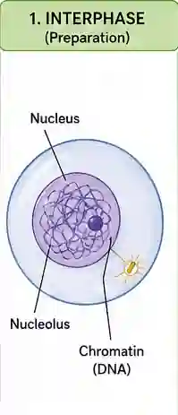
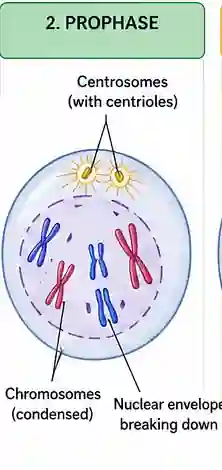
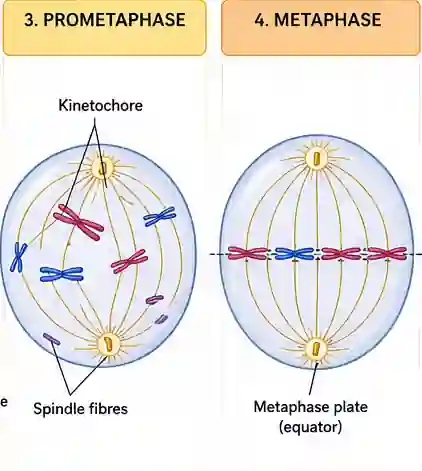
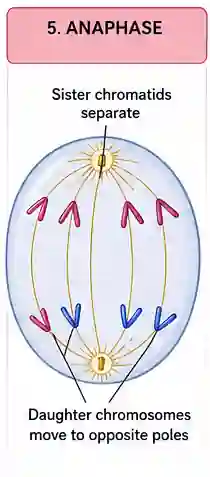
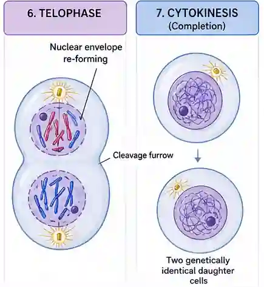

## Mitotic Cell Cycle

1. Interphase

2. Mitosis

3. Cytokinesis

### Interphase - 80% of cell cycle

* $G_1$ phase

  * **G**rowth

  * Duplication of organelles

  * Protein synthesis

  * Cytoplasm increase in size

* S phase Semi-conservative replication of DNA

  * Replication of DNA (check chapter 6)

* $G_2$ phase

  * Duplication of centrioles

  * Checkpoint of DNA, checks for any errors in the DNA

### Mitosis ($ {PMAT}$)

* **Prophase**

  * Nuclear envelope disappears

  * Nucleolus disappears

  * Chromosomes condense and become visible thread like structures

  * Centrioles starts to move to opposite poles and spindle fibers start to form

    

* **Metaphase (middle)**

  * Centrioles are at opposite poles of cell and spindle fibers form

  * Chromosomes line up at the equator

    

* **Anaphase (apart)**

  * Spindle fibers shorten

  * Sister chromatids are separated

  * Are now single chromosomes

  

* **Telophase**

  * Nuclear envelope and nucleolus reforms

  * Chromosomes decondense and appear as dispersed islands

    

Mitotic cell cycle

* You have to know what it looks like under a light microscope, as that's what comes in the exam

  * Metaphase

    * is when chromosomes line up in the middle

  * Anaphase

    * When sister chromatids are pulled apart to opposite poles

  * Telophase

    * is when you see 2 nuclei at opposite poles

  * Prophase

    * has no clear nuclear envelope, unlike interphase

    * Chromosomes condense and become visible

### **Cytokinesis**

* Pinching in and fusion of the cell surface membrane and dividing the cytoplasm into **roughly equal** parts.

* Golgi vesicles fuse to turn cell plate, which fuses with the cell wall

  

### Mitotic index

* Mitotic index is the percentage of cells in a population that are undergoing mitosis.

* It can be used to determine the rate of cell division in a tissue.

  $\text{Mitotic Index} = \frac{\text{Number of cells undergoing mitosis}}{\text{Total number of cells observed}} \times 100$