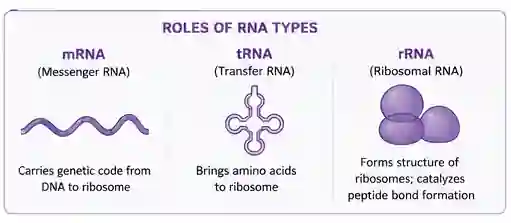

# Nucleic Acid and Protein Synthesis

## Structure of DNA Vs RNA

#|
||

Features

|

RNA (ribonucleic acid)

|

DNA (deoxyribonucleic acid)

||
||

Number of strands

|

Single strand

|

Double strand forms twist to form double helix

||
||

Bases

|

Adenine,Uracil, Cytosine,Guanine

|

Adenine, Thymine, Cytosine, Guanine

||
||

Type of sugar

|

Ribose sugar

|

Deoxyribose sugar

||
||

Hydrogen bonds

|

Absent

|

Present

||
|#

### Different types of RNA

* rRNA which forms the ribosome

* mRNA which encodes for proteins (messenger)

* tRNA (transfer)

#|
||

mRNA

|

tRNA

||
||

Doesn't have hydrogen bonds

|

Hydrogen bonds

||
||

no amino binding site

|

Amino binding  site

||
||

Less  numerous than tRNA

|

More numerous than mRNA

||
||

Has codons

|

Has anticodons

||
||

linear structure

|

Clover leaf shape

||
|#

