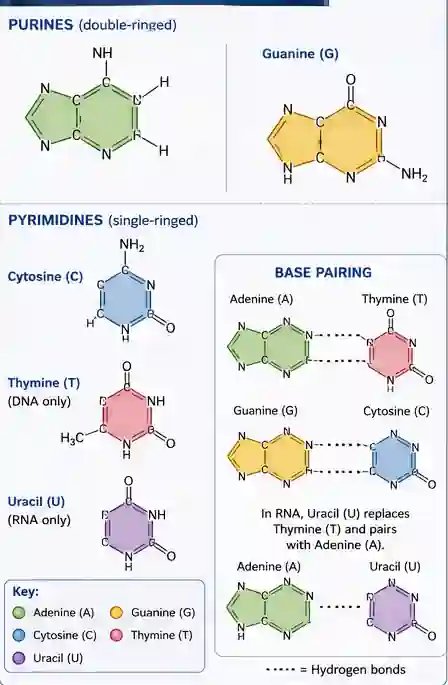

## Purines and Pyrimidines

* Purines:

  * Adenine

  * Guanine

* Pyrimidines: (CUT)

  * Cytosine

  * Uracil

  * Thymine

Purines have 2 rings while Pyrimidines have 1 ring

### Complementary base pairing rule

Adenine forms 2 hydrogen bonds with Thymine

Cytosine forms 3 hydrogen bonds with  Guanine

In RNA as adenine binds to uracil it's also forms 2 hydrogen bond together.