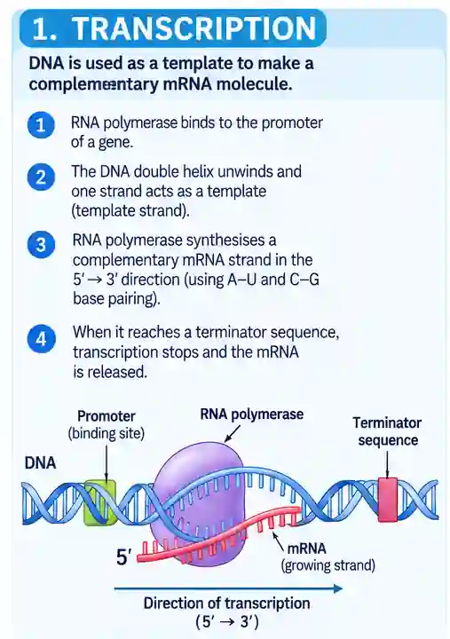

## Transcription

* A part of DNA unzips and unwinds as hydrogen bonds are broken down between nitrogenous bases

* 1 strand acts as a template and is called the transcribed strand, while the other is the non-transcribed strand

* Free activated nucleotides, which are lined up and arranged  by RNA polymerase and checked for mismatch, then makes the phosphodiester bond

* Hydrogen bonds are formed on their own according to the complementary base pairing rule $\mathrm{A=U}$ and $\mathrm{G\equiv C}$.

* Hydrogen bonds are broken between mRNA and DNA and DNA rezips

* mRNA exits out of nucleus through nuclear pore

