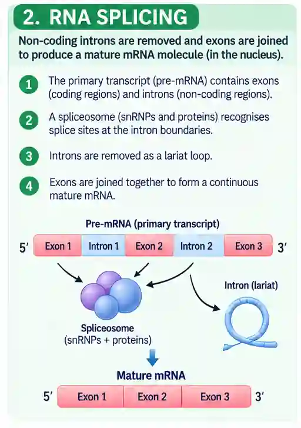

## RNA Splicing

* Splicing occurs in eukaryotes

* Removal of introns from the primary transcriptase (RNA) to form mRNA

* By spliceosome enzyme

* Exons are coding while introns are non coding

Exons are protein coding sequence of a gene. Remain in the final mRNA after splicing

Introns are non coding sequence found within a gene. Are between exons.