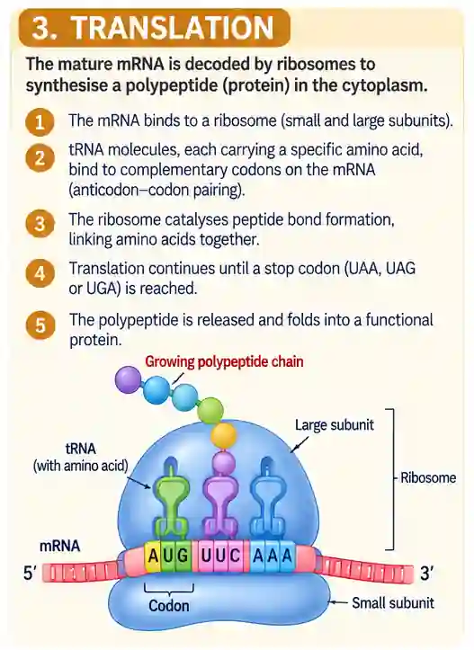

## Translation

At ribosome

* Has upper and lower sub-units

* mRNA attaches to the lower subunit while tRNA attaches to the upper subunit

* Exposing 2 codons at a time and 2 anticodons; they are complementary and form a hydrogen bond according to the complementary base pairing rule

  * Forming an amino acid held by tRNA

  * Joined by a peptide bond

    * By peptidyltransferase

  * Ribosome moves along until it comes across a stop codon, so stops translation

Polyribosome

* More than 2

* Several ribosomes work on the same strand to speed up the reaction