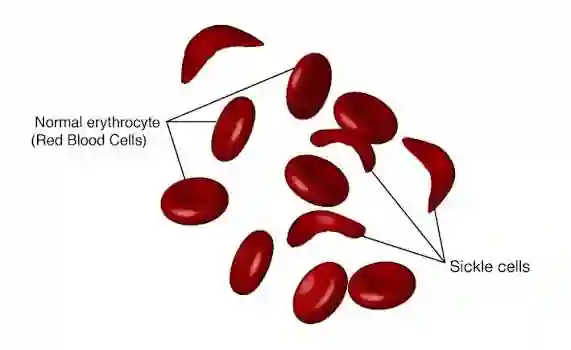

## Sickle Cell Anemia

* CTT -> CAT

* This is substitution mutation 

  * GAA -> GUA (codon)

  * CUU->CAU (anticodon)

* Instead of carrying glutamate it will carry valine

* Glutamate is hydrophilic while valine is hydrophobic so  haemoglobin is less globular so less soluble

This is known as haemoglobin S

Affects the beta chain

