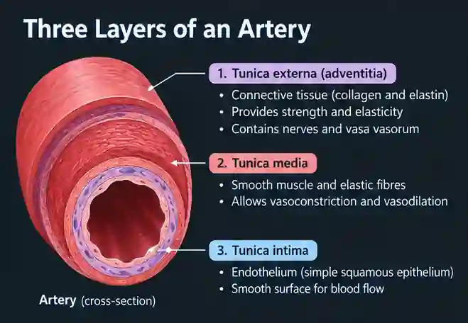
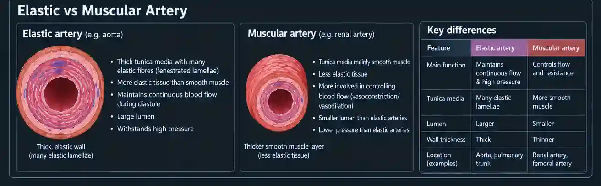
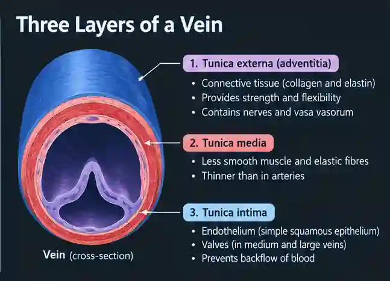

## Blood vessels

### Artery

* Transports of blood from Heart to all body organs.

  * Mnemonic: **A**(rtery) for away from the heart

* Narrow lumen:

  * To keep blood pressure high.

* Carries oxygenated blood except the pulmonary artery and umbilical artery.

**Layers**

1. Tunica intima

   * Consists of endothelium, which is a single layer of squamous epithelium.

   * Single layer of endothelium to reduce frictional resistance.

   * Folded to increase diameter during ventricular systole to avoid damage. And supported by connective tissue.

2. **Tunica media**

   * Contains elastic fibers, collagen fibers, and smooth muscle.

   * Thick to withstand high blood pressure.

   * Smooth muscles contract, narrowing the lumen, to increase blood pressure.

   * Elastic fibers allow the stretch & recoil of arteries.

3. **Tunica externa**

   * Contains elastic fibers and collagen fibers.

   * To stretch and recoil and withstand high pressure.

**Elastic artery v/s Muscular artery**

#|
||

Features

|

Elastic artery

|

Muscular artery

||
||

Location

|

Closer to the heart (e.g., Aorta, Pulmonary Artery).

|

Further from the heart

||
||

Primary function

|

Dampen the pressure surge from the heart.

|

Distribute blood to specific organs/regions.

||
||

Wall composition

|

High proportion of elastic fibers in tunica media.

|

High proportion of smooth muscle in tunica media.

||
||

Response to pressure

|

Expand and recoil to maintain continuous flow.

|

Contract or dilate to regulate blood flow volume.

||
||

Lumen size

|

Relatively large.

|

Relatively smaller

||
|#

### Veins

* Transports blood towards the heart

* Wide lumen:  to reduce resistance when blood flows.

* Thin wall: carries blood under low pressure and relies on external forces to pump blood back to the heart.

* Has valves: prevents  backflow of blood

**Layers**

1. Tunica Intima: Made of endothelial cells.

2. Tunica Media: Has less elastic fibers and less smooth muscle, as low blood pressure and blood vessels do not stretch.

3. Tunica Externa: Contains elastic fibers & collagen fibers to provide structural integrity

### Capillary

Allows rapid transfer of substances, e.g., oxygen, and they lack a tunica media and tunica externa entirely; they consist solely of a single layer of endothelial cells resting on a basement membrane.

**Structure of capillaries**

* Thin walls

  * One cell thick of squamous epithelium to shorten diffusion distance for faster rate of diffusion.

* Pores

  * Allow movement of substances down a pressure gradient.

* Large capillary network

  * To increase surface area

* Narrow lumen

  * Of 7 micrometer same size as red blood cell.

### Photomicrographic images

