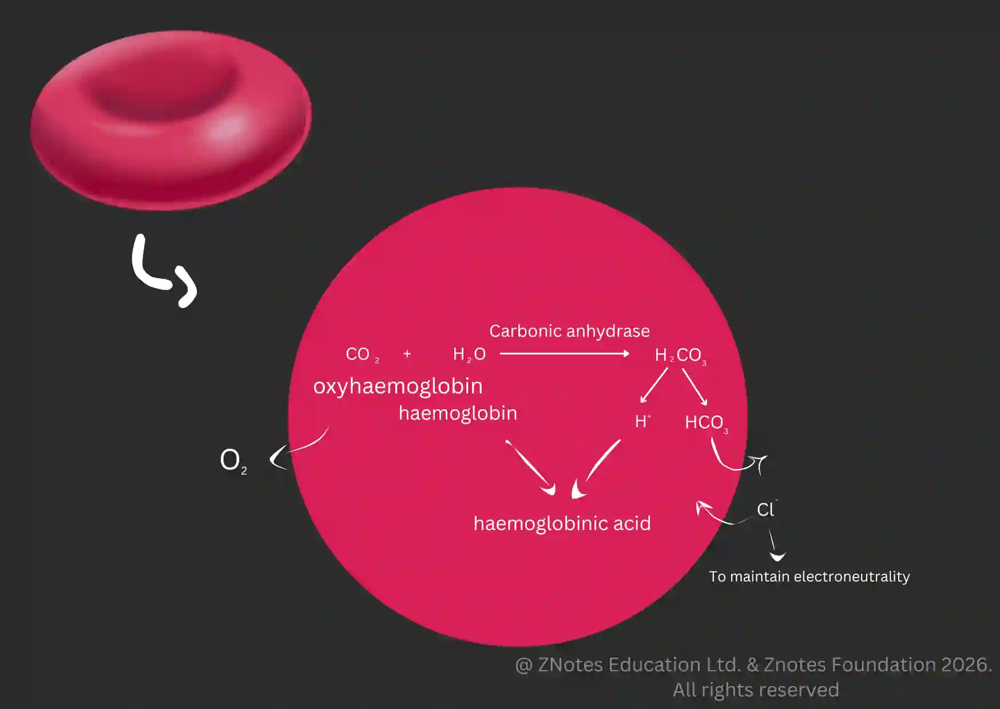

## Carbon dioxide in the active muscle

* Dissolved in Plasma: 5% of carbon dioxide simply dissolves in plasma

* Bind with **haem**oglobin to form carbamino haemoglobin

* React with water under carbonic anhydrase

The chloride shift is a vital process occurring in the blood to facilitate the transport of carbon dioxide from tissues to the lungs.

**The process:**

1. Carbon dioxide diffuses into red blood cells and reacts with water to form carbonic acid ($H_2CO_3$), catalyzed by the enzyme carbonic anhydrase.

2. Carbonic acid dissociates into hydrogen ions and bicarbonate ions.

3. To prevent a buildup of negative charge inside the cell, $HCO_3^-$ ions diffuse out of the red blood cell into the plasma.

   * To maintain electrical neutrality, chloride ions diffuse from the plasma into the red blood cell.

4. The Hydrogen ions produced in step 1 bind to oxyhemoglobin. This reduces the affinity of hemoglobin for oxygen. 

   * Consequently, the oxyhemoglobin releases its oxygen

**Importance:**

* Maintains pH: By converting $CO_2$ into bicarbonate, the blood can transport carbon dioxide without significantly altering the pH of the plasma.

* Facilitates Diffusion: By removing the products of the carbonic anhydrase reaction, it ensures that the gradient for $CO_2$ diffusion remains steep, allowing for the continuous uptake of $CO_2$ from respiring tissues.