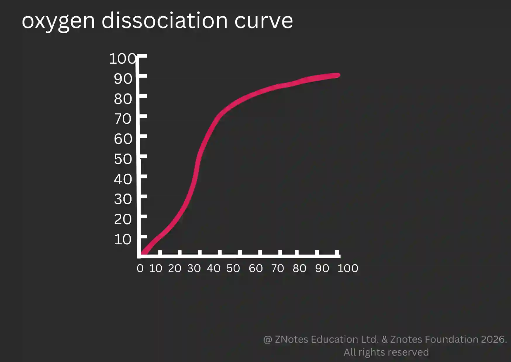

## Oxygen dissociation curve

Relationship between partial pressure of oxygen and percentage saturation of haemoglobin. Graph is S-shaped (Sigmoid curve)

* In the lungs:
  * pO₂ is high, around 13 kPa.

  * Haemoglobin becomes almost fully saturated with oxygen.

  * This allows haemoglobin to load oxygen efficiently.
* In respiring tissues:
  * pO₂ is lower, around 5 kPa or less.

  * Haemoglobin has a lower affinity for oxygen and releases oxygen.

  * This supplies oxygen to cells for aerobic respiration.
* The steep section of the curve is important because a relatively small decrease in pO₂ causes a large decrease in haemoglobin saturation, allowing substantial oxygen release to actively respiring tissues.

