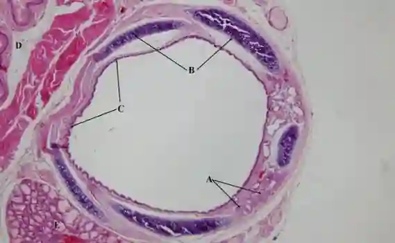
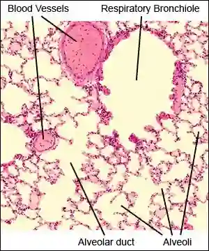

## The structures in detail

### Trachea

* Main airway (windpipe) leading from the throat.
* Has C shaped cartilage to support the trachea.
* Ciliated cells: tiny hair like projection which move in one way to get rid of mucus which traps bacteria and dust
* Goblet cells: secrete mucus to trap bacteria and dust

It has

* Cartilage: keeps airway open and reduce resistance and prevents collapse.

* Cilia: carries mucus upwards.

* Goblet cells and mucous gland: secrete mucus

* Smooth muscle: contract or relax to adjust diameter of airways.

### Bronchi/bronchus

* The trachea divides into two primary bronchi, one entering each lung.

* Has irregular shaped cartilage.

* Branches into bronchioles

It has:

* Cartilage

* Cilia

* Goblet cells and mucous glands

* Smooth muscle

### Bronchioles

* The bronchi branch repeatedly into smaller, narrower tubes

It has:

* Cilia

* Smooth muscle

### Alveoli

* Millions of tiny, grape-like air sacs located at the ends of the smallest bronchioles. They provide a massive surface area for gas exchange.

* Has elastic fibres in the alveolar walls that allow the alveoli to stretch during inhalation and recoil during exhalation. This helps maintain ventilation and pushes air out of the alveoli, allowing fresh air to enter during the next breath.

* Has squamous epithelium: a type of tissue made of thin, flat, scale-like cells. It forms protective barriers and allows the rapid diffusion of substances such as gases and fluids by providing a short diffusion distance. Oxygen and carbon dioxide diffuse across the squamous epithelium, the shared extracellular basement membrane, and the capillary endothelium.

* *Note:  Include the extracellular basement membrane in the diffusion distance calculation*

* **Adaptations of alveoli**

  * Thin (one cell thick) for short diffusion distance of gases.

  * Large surface area for rapid rate of diffusion.

  * Surrounded by a network of blood capillaries to maintain a diffusion gradient

  * Moist surface for dissolving the diffusion

* **Alveolar macrophages** 

  * Alveolar macrophages are immune cells found in the alveoli.

  * They phagocytose foreign particles, such as dust and microorganisms, that enter the lungs.

  * This is particularly important in areas without ciliated epithelium, where the mucociliary escalator cannot remove particles.

  * The macrophages engulf and digest these particles, helping to protect the gas exchange surfaces from infection and damage.

