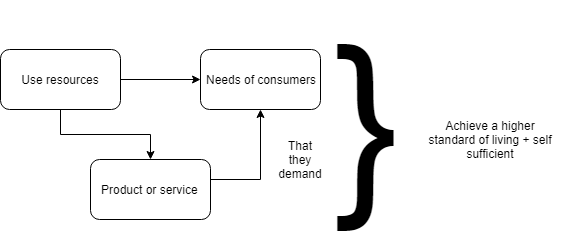

# Enterprise

## Purpose of Business Activity

* Businesses aim to add value to raw materials and semi-finished goods in order to satisfy needs and wants of consumers.
* This helps raise living standards of the economy as businesses will employ people for production.

