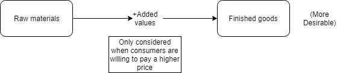

## Added Value

* $\text{Added value} = \text{selling price} - \text{cost price}$
* Added value is not the same as profit
* Business is successful if the consumer is willing to pay more than the cost of materials.

### **How to increase added value**

1. Increase selling price by providing higher-quality goods (higher-quality raw materials), increasing advertising, changing packaging, or making small improvements in the product.
2. Decrease cost price by reducing wastage through lean production methods, finding cheap supplies, reducing product quality, and increasing efficiency by training workers and using advanced technology.

