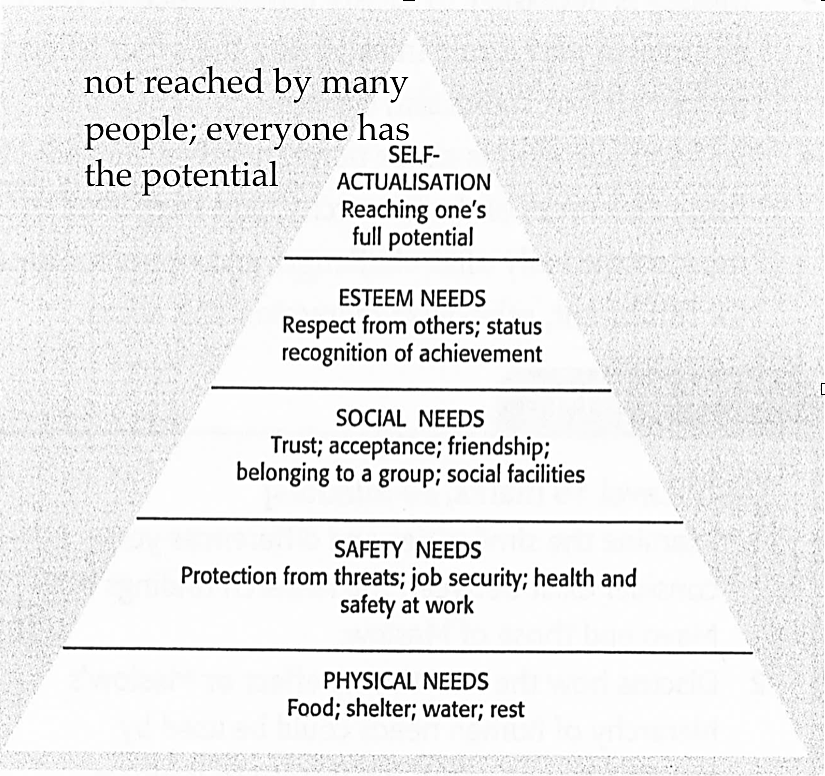

## Abraham Maslow – Hierarchy of human needs

* He categorised employee needs into 5 levels.
* Every employee starts at the lowest level

 

* Physical needs – food, shelter, water, rest
* Safety needs – job security, health and safety
* Social needs – trust, friendship, teamwork, acceptance
* Esteem needs – respect, status, recognition, achievement
* Self-actualisation – reach one’s full potential, challenging and creative work
* Regression is possible – once one need is satisfied, greater quantity of the same need will not motivate people
### Limitations-
  * Everyone has different needs
  * Difficult and impractical to identify for each worker and have separate measures for each
  * Self-actualisation is never permanently achieved

