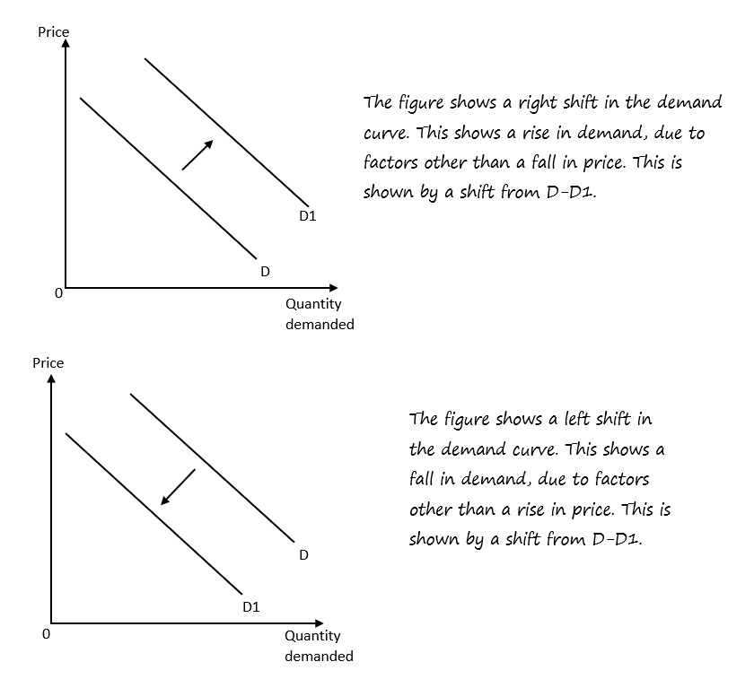
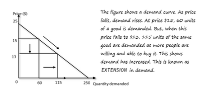
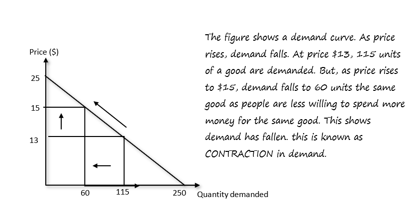
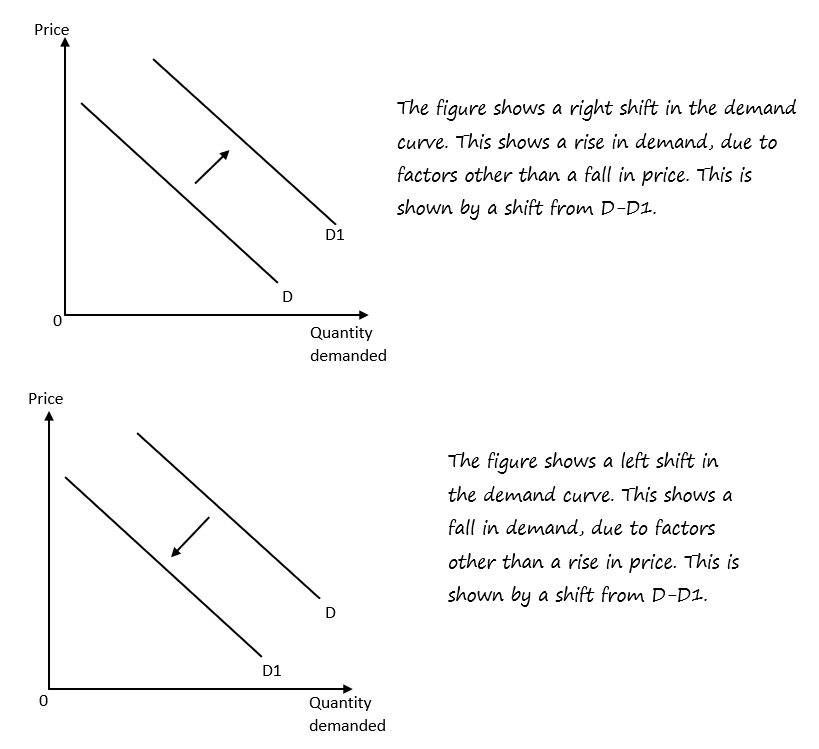

## Demand

* **Demand:** The quantity consumers are willing and able to buy at a given price in that specific time period

Movements in a demand curve

    **Factors affecting demand**

* Changes in consumer income
* Changes in prices of related goods
* Changes in age and population structure
* Fashion, tastes and attitudes
* Advertising and promotion