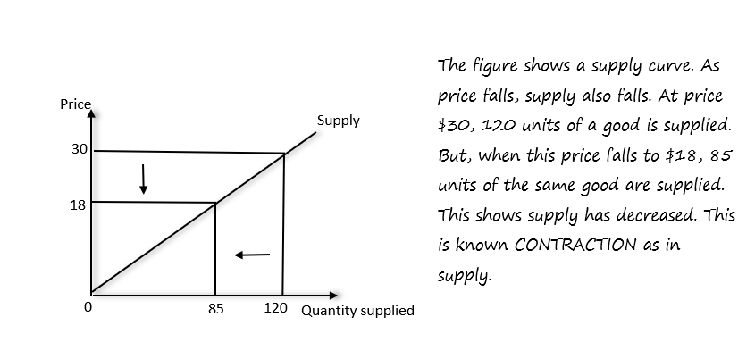
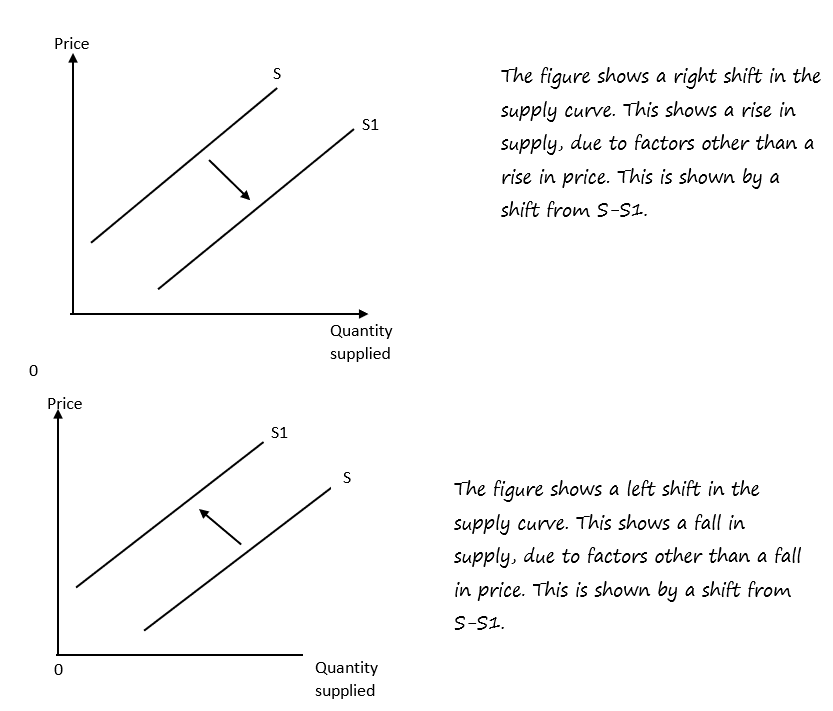

## Supply

* Supply: The amount of a product that businesses are willing to offer at a specific price during a certain time period.

     

**Factors affecting supply**

1. Costs
2. Taxes
3. Subsidies
4. Weather conditions
5. Advances in technology

