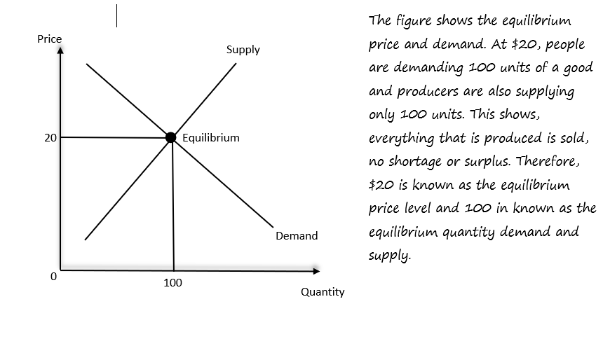

## Equilibrium

* It is the price level where demand = supply
* There is no shortage (demand higher than supply) or surplus (supply higher than demand)
* Disequilibrium is when demand is not equal to supply (there’s either a surplus or shortage)

 