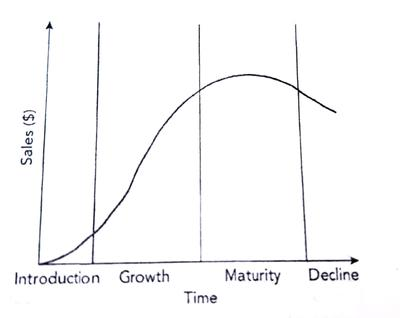

## Product life cycle

* The stages a product goes through from its development to its decline
* Product portfolio analysis involves making decisions about how to allocate resources effectively between the range of products. PLC is one form to do so.

### Stages of PLC

* Introduction
  * Low sales
  * Increase slowly
* Growth
  * Significant growth in sales
  * Few competitors start entering the market
* Maturity/saturation
  * Sales remain constant
  * Many competitors are in the market
* Decline
  * Sales fall rapidly
  * May occur due to changes in technology, tastes, etc

### Product Life Cycle Graph:

 

### Extension strategies

* Strategies used to extend the maturity stage of the PLC
* Examples –
  * Selling in new markets
  * Repackaging and relaunching
  * Finding new uses
  * Sales promotion techniques
  * Adding new features
  * Finding new markets

### Marketing Mix and Phases of PLC:

<html> <table border="1"> <tr> <th>Product Life Cycle Stage</th> <th>Price</th> <th>Promotion</th> <th>Distribution</th> <th>Product</th> </tr> <tr> <td>Introduction</td> <td> <ul> <li>Price may be high (skimming) or low (penetration) compared to competitors.</li> </ul> </td> <td> <ul> <li>High levels of advertising are needed to inform consumers about the product.</li> </ul> </td> <td> <ul> <li>Distributed in limited outlets, possibly high-end stores if skimming is used.</li> </ul> </td> <td> <ul> <li>Basic model with few variations.</li> </ul> </td> </tr> <tr> <td>Growth</td> <td> <ul> <li>If successful, prices might increase after initial low pricing.</li> </ul> </td> <td> <ul> <li>Encourage repeat purchases and build brand loyalty through promotion.</li> </ul> </td> <td> <ul> <li>Available in more outlets where demand is strong.</li> </ul> </td> <td> <ul> <li>Product improvements to keep consumer interest.</li> </ul> </td> </tr> <tr> <td>Maturity</td> <td> <ul> <li>Prices need to stay competitive as more competitors enter the market.</li> </ul> </td> <td> <ul> <li>Focus on branding to highlight differences from competitors.</li> </ul> </td> <td> <ul> <li>Wide distribution including new channels.</li> </ul> </td> <td> <ul> <li>New models, colours, and accessories introduced as part of product extensions.</li> </ul> </td> </tr> <tr> <td>Decline</td> <td> <ul> <li>Prices may drop to clear out inventory, but could rise if there's a niche market.</li> </ul> </td> <td> <ul> <li>Limited advertising, mainly to inform about lower prices.</li> </ul> </td> <td> <ul> <li>Unprofitable outlets are phased out.</li> </ul> </td> <td> <ul> <li>Slowly withdraw the product and prepare for new product launches.</li> </ul> </td> </tr> </table> </html>

