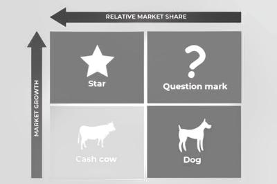

## Boston Matrix Analysis:

A method of analysing the product portfolio of a business in terms of market share and market growth.

It consists of:

* Star: High market share, High market growth. It is highly successful in a growing market. However, to maintain its market position, it needs high promotion costs. Therefore, the business needs to invest heavily to sustain growth and profitability.

  
* Cash Cow: High market share, Low market growth. It is established and profitable with high cash flow and requires low promotional costs due to strong brand awareness. Due to this, the business mostly needs to maintain it and use the profits to support other products.

  
* Question Mark: Low market share, High Market growth. It requires significant investment and promotion as it has an uncertain future. These includes evaluating quickly and consider redesign, rebranding, or even withdrawal from market if sales fail to improve. 

  
* Dog: Low market share, Low market growth. It has little return or future potential, considering weak sales and cash flow. Therefore, the business should consider replacing or withdrawing such products from the market.

The image shows how to represent it graphically:

 

### Impact of Boston Matrix Analysis on Marketing Decisions:

The Boston Matrix helps in:

* Evaluating Products: Understanding how well current products are performing and their market position.
* Planning Actions: Deciding what to do with existing products and how to introduce new ones.

### How to make marketing Decisions Based on the Matrix:

* Building Question Marks: Invest in advertising or expand distribution for products with potential but currently low market share. Use profits from successful products (cash cows) to fund this.

* Holding position of Stars: Keep supporting high-performing products to ensure they stay successful and continue to grow.
* Milking Cash Cows: Use the profits from successful, established products to fund other products or initiatives.
* Divest: Consider stopping production of underperforming products. This decision involves considering impacts on the workforce and how to use any freed-up resources effectively.

  

These strategies work well with a balanced product portfolio. Too many poorly performing products can limit the firm's ability to invest and grow.

### Limitations of the Boston Matrix:

* It cannot predict future product performance. Therefore, continuous market research is needed to understand future trends which is costly.
* Managers must consider the impact of competitors, technological changes, and economic conditions, which the Matrix does not account for.
* The Boston Matrix is a planning tool. It oversimplifies the factors affecting product potential success and may not capture all complexities.
* It assumes higher market share leads to higher profits, but this isn’t always true if profits are reduced by low prices.

