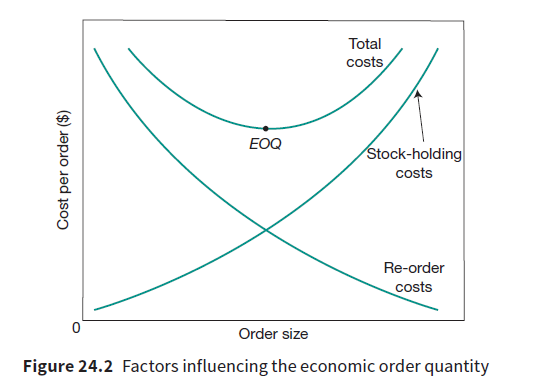

## Optimum order size

* Operations managers must ensure they have enough stocks to allow for smooth production.
* Operations managers usually order their inventories on the basis of the Economic Order Quantity (EOQ)
* EOQ is the optimum inventory level where the costs incurred are minimum (both re-ordering costs and stock-holding costs)

   
* The reorder costs decrease as the order size increases, showing a downward sloping graph.
* Whereas, the stock-holding costs increase as the order size rises, showing an upward sloping graph.
* The Economic Order Quantity is shown where the stock-holding costs and re-order costs curves intersect.

