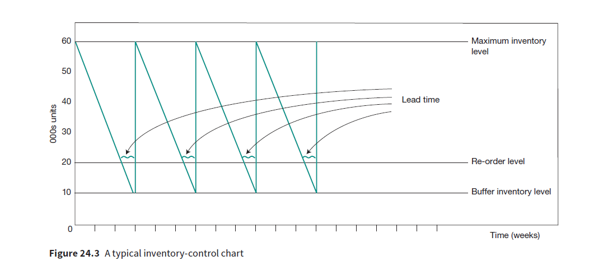

## Inventory control graphs 

* Inventory-control graphs record the buffer inventories, maximum inventory.
* They help in determining the right order time and quantity.
* Buffer inventory – minimum inventory held to deal with delays in delivery and unforeseen demand changes 
* Maximum inventory level – the maximum quantity of inventory the company can hold, space and financial terms 
* Reorder quantity – the number of units ordered each time
* Lead time – time taken for the supplier to deliver the raw materials 
* Reorder stock level – the level of inventory which will trigger a new order 

 The maximum inventory is 60000 units. The buffer inventory level is 10000 units and the reorder level is 20000 units. The reorder quantity is 50000 units (60000-10000) 