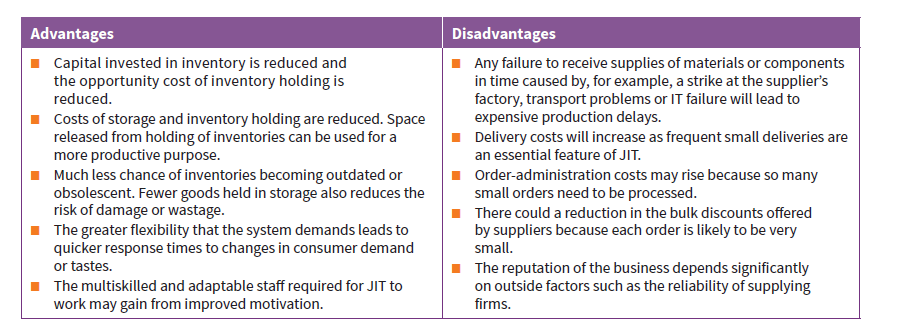

## Just in time (JIT) inventory control 

* It is an inventory control system which avoids the need to hold inventories. They arrive just as and when required 

### Requirements for JIT 

* Excellent relations with supplier 
* Flexible and multiskilled production staff 
* Flexible equipment and machinery 
* Accurate demand forecasts 
* Latest IT technology 
* Excellent employee-employer relations 
* Quality must be priority 

### Advantages and disadvantages 

##  JIT evaluation 

* JIT requires employees to be accountable for their performance and suppliers to be reliable 
* JIT may be unsuitable when:

* Costs of halting production exceed inventory holding costs 
* Expensive IT systems cannot justify potential cost savings 
* Global inflation makes holding inventories cheaper 

